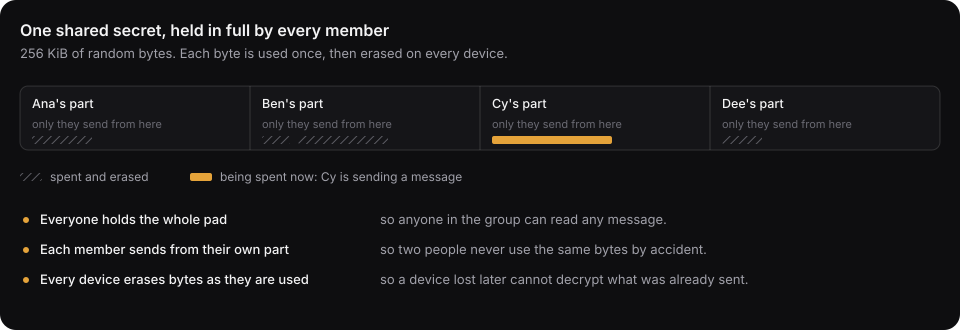
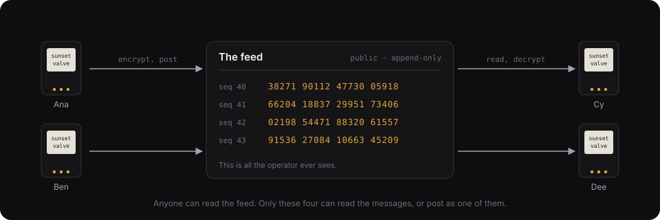

# Cahoots

Cahoots is a private network that only exists between people who have met in person. Meeting takes five minutes in a room: your devices make a shared secret that nobody outside the room has seen. After that you can message, log in and tunnel to each other with keys that no server ever had, and the keys rotate from that secret for years.

## The mental model

A one-time pad is a file of random bytes that a group of people share. To encrypt a message, you XOR it with fresh pad bytes. To decrypt, you XOR it with the same bytes. Each byte is used once and then destroyed. If the pad is truly random and never reused, no amount of computing power can break the encryption. That includes quantum computers.

The hard part is getting the same random file to every member without anyone else seeing it. Cahoots does this in person, at a **ceremony**:

1. A group meets in a room. Each person holds a Cahoots badge or a phone.
2. Each device generates random bytes from its hardware random number generator.
3. The devices swap those bytes over a wired touch link, or by showing each other animated codes. Each contribution is encrypted to the other members before it leaves the device, so a camera or an antenna in the room learns nothing.
4. Every device XORs all contributions into one shared pad.
5. Every device signs the list of seats with a key it made for this group, so the group has a signed roster and every member a key to sign with later.
6. The members read six check words aloud to confirm every device holds the same pad.


The group is now a **circle**. The pad is a key budget. Spending 32 bytes seeds a session of any size in WireGuard, HPKE, or age. An attacker then has to break both the math and the pad. Spending one byte per byte encrypts a short message that nothing can break. The device records every spend in a ledger and erases the bytes, so no key is ever used twice.



Ciphertext travels over the **Numbers Station**, an append-only public feed. Anyone can read it. Only circle members can decrypt or forge an entry.



A circle can also give a seat to a hosted software member, such as an AI agent. That member's copy of the pad lives inside a [Turnkey Verifiable Cloud (TVC)](https://docs.turnkey.com/features/verifiable-cloud/overview) enclave, and a pinned policy decides each read and send. This integration is optional. Circles without a hosted seat have a simple guarantee: nobody who runs the feed can read the circle.

## A badge with the chip

On a V1 board with the NXP SE051 secure element, the chip makes and holds each circle's seat key, and the key never leaves it. With it, a badge can:

- Show a proof from the chip that the seat key lives in it (attestation).
- Sign SSH logins, git commits and files. A laptop program asks, the badge shows the user and host, the commit's author and subject, or the file's first line and size, and it signs when both buttons are pressed.
- Sign a contact card and share its circle's card seal key, so a circle can swap cards.
- Sign grants as CBOR Web Tokens.
- Give an agent a grant to sign git commits on a budget, so each commit needs no press. The chip counts the uses.

A badge also keeps several circles at once, with nothing linking them, whether or not it has the chip: up to 16 on the Pico 2, and 4 on the Nano ESP32, which has no chip.

All of this is built and tested against a software chip, and on 2026-10-29 a Pico 2 with the SE051 did it on the bench: a ceremony with its seat key made in the chip, then a file and a git commit signed by the chip and verified by `ssh-keygen` and `git`. Attestation against NXP's root still waits. See [the roadmap](docs/plan.md) (M4f) and the [host program](crates/host/README.md).

## Repository layout

Every Rust crate lives under `crates/`. The PWA lives under `web/app`.

| Path | Crate | What it holds | Status |
|---|---|---|---|
| `crates/core` | `cahoots-core` | The protocol: parameters, commit-then-reveal ceremony, XOR combine, check words, circle ID, message codec with one-time Poly1305, spent-range ledger, spend ordering, touch-link framing. `no_std` + `alloc`. | done (M1) |
| `crates/vectors` | `cahoots-vectors` | JSON test vectors generated from core. Every client must reproduce them. | done (M1) |
| `crates/objects` | `cahoots-objects` | The four objects a seat signs, as canonical CBOR in COSE_Sign1: grants, approvals, facts and receipts, each verified against the circle's signed manifest, with a JSON projection and vectors. `no_std`. | done (M1c) |
| `crates/custodian` | `cahoots-custodian` | The `Custodian` trait (`psk`, `spend`, `remaining`), the CBOR request and response messages, and `serve`, which answers a request only when the device consents. The `Chip` family (attest, sign for SSH, sign a card or a grant, release a seal key) is in [protocol](docs/protocol.md) section 6; a laptop program and a badge must come from the same release. `no_std`. | done (M4e) |
| `crates/chip` | `cahoots-chip` | The `ChipOps` trait a badge's key store speaks, a software chip for tests, and the SE051 backend (feature `se05x`) the Pico 2 uses. `no_std`. | done in software (M4f); the chip on the bench is not |
| `crates/provider` | `cahoots-provider` | The memory and encrypted-file custodians, the HKDF session-key derivation, and the old `PadProvider` name for `Custodian`. | done (S1) |
| `crates/hpke` | `cahoots-hpke` | HPKE `mode_psk` adapter (X25519 and X-Wing suites). | done (S1) |
| `crates/age-plugin-cahoots` | `age-plugin-cahoots` | age plugin: recipient `cahoots:<circle>`. | done (S1), untested against the `age` CLI |
| `crates/wireguard` | `cahoots-wireguard` | WireGuard `PresharedKey` helper and the `cahoots-wg` CLI: announce, peers, issue, accept over the feed or by paste; `--apply` runs `wg set`. | done (S1, N1); `scripts/wg-demo.sh` runs a two-host tunnel in CI |
| `crates/relay` | `cahoots-relay` | Numbers Station client shared by the CLIs. | done |
| `crates/wasm` | `cahoots-wasm` | Browser bindings: ceremony, circle, fountain-coded animated QR, QR rendering. | done (M2) |
| `web/app` | | Offline PWA phone and laptop client, including hello words for calls. | done (M2), camera scanning untested |
| `crates/hal` | `cahoots-hal` | HAL traits, the ceremony driver over any set of touch links (a pile, a ring, a pair), pile discovery (seat and count from the stack), SP 800-90B health tests, persistent ledger. `no_std`. | done (M4a) |
| `crates/badge` | `cahoots-badge` | The badge crate: the `Board` trait and the badge program that runs on it. It boots, runs the ceremony, keeps the circle, and shows the words, a key as a code, or serves custodian requests. `no_std`. | done (M4e) |
| `crates/host` | `cahoots-host` | Desktop simulator: socket Link, file PadStore, PNG Display. Four processes, each with a socket to both neighbours, run a ceremony. | done (M4a) |
| `crates/esp32s3` | `cahoots-esp32s3` | `esp-hal` firmware for the Arduino Nano ESP32 with the 1.54" e-paper and two buttons: the four HAL traits on real hardware, the pile over USB with the laptop as the other cards. Built with the esp toolchain, outside the workspace. | in progress (M4b, first board) |
| `crates/rp2350` | `cahoots-rp2350` | `rp235x-hal` firmware for the Raspberry Pi Pico 2 on V1's pin map: the e-paper, two buttons, the chip's TRNG, the pad and ledger in flash through the boot ROM, USB to a laptop and two UARTs up and down a pile. | done on a breadboard Pico 2 (M4b, 2026-10-27): a ceremony with the laptop as the pile, the circle kept in flash |
| `crates/dabao` | | Xous app for the Baochip-1x Dabao, the V2 card. | placeholder (M4c, M5) |
| `crates/chat` | `cahoots-chat` | End-to-end chat keyed by the circle root: epoch keys, sender ratchets, ChaCha20-Poly1305, plus the `cahoots-chat` CLI demo. | done (C1, C3) |
| `crates/station` | `cahoots-station` | The Numbers Station relay: hash-chained log, reuse refusal, long-poll feed, display page, per-client rate limit, log cap, Dockerfile, and the [deploy recipe](deploy/relay/README.md) for the default relay. | done (C2, C7; `relay.cahoots.network` is up); the [TVC](https://docs.turnkey.com/features/verifiable-cloud/overview) deploy pending |
| `crates/fuzz` | | `cargo-fuzz` targets for every parser. Not a workspace member. | done |
| `docs/` | | Protocol spec, threat model, use cases, plan, ceremony guide. | |

## Build and test

```sh
cargo test --workspace
cargo clippy --workspace --all-targets -- -D warnings
cargo build -p cahoots-core --no-default-features --target thumbv7em-none-eabi   # no_std check
cargo build -p cahoots-core --target wasm32-unknown-unknown
cargo run -p cahoots-vectors -- --check     # committed vectors are current
```

The pinned toolchain is in `rust-toolchain.toml`. CI runs these commands, with `--all-features` on clippy and test, and also builds `cahoots-hal` and `cahoots-chat` for `thumbv7em-none-eabi`.

## Security limits

- Confidentiality is information-theoretic only for circles labelled `TRNG`, and only while no pad byte is reused. `CSPRNG` circles are computationally secure.
- The circle tag proves that some member wrote a message, not which member.
- A stolen device exposes that device's pad.
- Erasure on phone storage is best effort.
- Circles that seat an agent trust the enclave with their pad.

See `docs/threat-model.md` for the full list.

## What it is for

`docs/tiers.md` defines the device tiers, from a phone (T0) to inspected silicon (T4), and the rule that a circle is only as protected as its least protected member. `docs/use-cases.md` lists concrete uses: group chat, and bootstrapping WireGuard and mesh networks from a ceremony. `docs/gatherings.md` is the concept of a card for every gathering: storage, messages from old circles, the web of trust a card accumulates, and a social network with no accounts. `docs/attested-data.md` surveys what a network of attested sensor readings, signed by the badge's key store chip, could be used for. `docs/diy-badge.md` is how to build a badge, in any of the three hardware families. `docs/plan.md` is the roadmap. `docs/glossary.md` defines the terms.

## Working rules

Correctness of the crypto is the product. Every spend path erases before output. Every tag compare is constant time. The message decoder is property-tested against arbitrary bytes. The code uses standards where they exist: Poly1305 (RFC 8439), BIP-39 words, HPKE (RFC 9180), and HKDF (RFC 5869).
