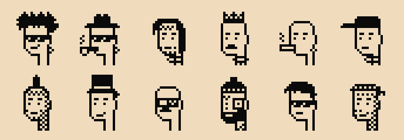

# Cahoots, the faces

A **cahoot** is a badge’s pixel portrait. A beanie, a moustache, a pair of shades: a few black squares give otherwise identical devices a face you can remember.

The plan is for each badge to generate its own cahoot once and keep it. You would see it on the badge’s idle screen, then recognize the same face when you met again.



## A familiar face for your badge

At a gathering, a cahoot would help you pick your badge out of a pile or remember which one belongs to someone you just met. It belongs to the badge, rather than to any one circle, so joining another circle would not give it a new face.

We also want the same portrait to appear beside a member’s name in contact cards and circle rosters. Those integrations are planned.

The picture is a visual cue. Two badges can have the same face, and anyone can copy one. To check who belongs to a circle, Cahoots uses signing keys and the circle’s signed membership record.

## How the faces are drawn

Each portrait fits on a 24 × 24 grid and uses only ink and paper. The large pixels and clear gaps between features help it stay legible on the badge’s small e-paper screen.

The generator chooses a head, hairstyle, eyes, mouth, accessory, and hat. Those layers give you everything from a bare head and a smile to a mohawk, monocle, or crown. Some features are deliberately less common than others.

The choices come from a hash of a seed: the same seed always produces the same portrait. The intended seed is randomness generated by the badge. The portrait does not need to be stored or assigned by a server.

## What works today

The face generator and the examples above are implemented. The generator is also written in Rust, in [`crates/core`](../crates/core/src/faces.rs), and it draws the same face as the Python for every seed. The phone app shows a face for each seat in a circle. For now that face comes from the seat’s public key, so a person’s face is different in each circle.

Generating and saving a badge’s own cahoot, showing it while idle, and carrying it into the app are still to be built. A badge does not yet have a permanent face waiting to be displayed.

That work is tracked as **M4i, The idle screen**, in the [hardware roadmap](plan.md#hardware).

## Try the generator

From the repository root:

```sh
python3 site/art/gen.py
```

This regenerates the example faces and the other site illustrations. The generator lives in [`site/art/gen.py`](../site/art/gen.py): `punk(seed)` returns a portrait as SVG, and `punk_traits(seed)` lists its features. These functions still use the older “punk” name.
