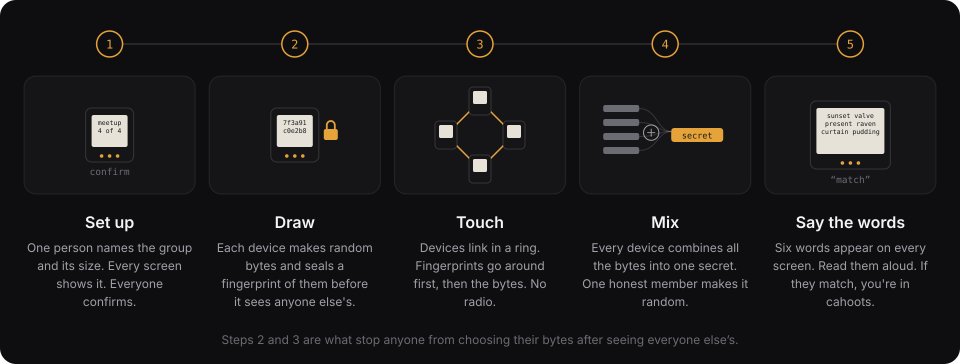

# Ceremony guide

A draft for meetup hosts. It will be finished in M7, after the first ceremonies on real hardware.

## Before

1. Every member charges their badge or phone.
2. The leader picks a circle name, the member count, and whether the circle seats an agent. If it does, the software says so before anyone confirms: that circle trusts the enclave with its pad.
3. Members who want YubiKey entropy run `cahoots-yk` on a laptop and load the bytes onto their device first.

## During

1. The leader starts the ceremony. Every device shows the parameters. Every member confirms them.
2. Devices touch in a ring. Wait for every device to show "all commitments held".
3. Devices stay in the ring while they reveal. Wait for "pad complete".
4. Each device shows six check words. One member reads theirs aloud. Everyone else confirms their device shows the same six words, in the same order.
5. If any device differs, restart from step 1. Do not use the pad.

## After

- Each device keeps only the pad. Contributions are erased.
- The circle label (`TRNG` or `CSPRNG`) is shown on every device. It decides which security claim the circle can make.
