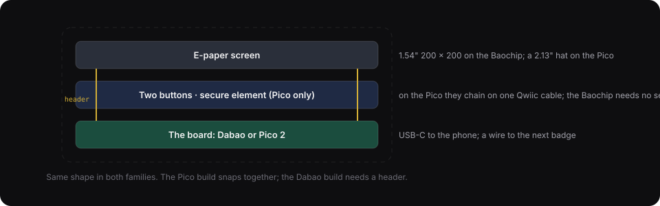
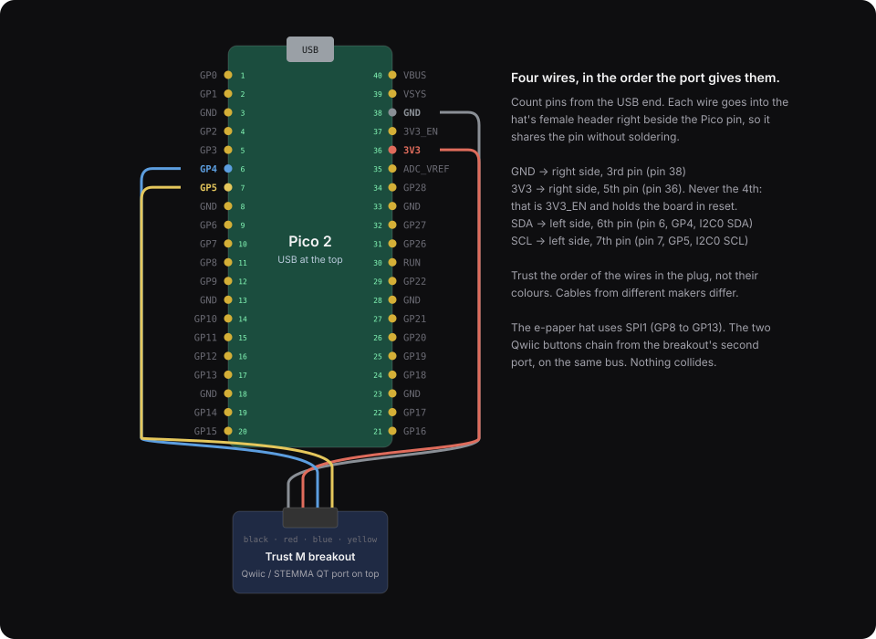

# Build a badge

Cahoots runs on any board that can do four things: make random numbers, store the pad and erase parts of it for real, show six words, and talk to the next badge over a wire. Those four are the HAL (`crates/hal`). A board that implements them and completes a ceremony is a Cahoots badge, and its README says which [tier](tiers.md) it reaches and why.

Two hardware families come first, and more can follow.

| Family | Board | What it is for | Tier | When |
|---|---|---|---|---|
| **Baochip** (native, fully supported) | Dabao evaluation board, Baochip-1x | The badge we stand behind. RISC-V, a hardware key store, on-chip RRAM, silicon you can inspect. No radio. | T3; T4 for anyone who inspects the chip | Boards ship 15 December 2026 |
| **ESP32-S3** (tinkering, first firmware) | Arduino Nano ESP32 | The board on the bench, so the firmware runs here first: `crates/esp32s3`, with the 1.54" module and two tactile switches wired as in [hardware/nano-esp32-epaper](../hardware/nano-esp32-epaper/README.md). Radio present, off by firmware; pad plaintext on flash until flash encryption is turned on. | T1 | Now |
| **Raspberry Pi Pico** (tinkering) | Pico 2 or Pico 2 W, RP2350 | Buy it today anywhere. Wi-Fi on the W for tinkering, a huge ecosystem, WebUSB to the phone. Needs a $5 secure element to be honest about its tier. | T2 | Now |

Both run the same Rust core and the same ceremony. Both are USB devices, so the browser app can drive either one. The RP2350 can boot its RISC-V cores instead of its Arm cores, so the firmware can be RISC-V on both.

**Status: the ESP32-S3 badge runs the pile and the ceremony on the Nano (`crates/esp32s3`). The Baochip and Pico badges are not built yet.** This page is the plan we are building to. We will build them ourselves and replace this line with what we learned.

## The shape both families share

- **An e-paper screen.** The manufactured badge uses a 1.54" 200 × 200 e-paper panel, and the DIY builds use e-paper too. It holds the six words with no power, it is readable in sunlight, and it never needs to animate: a single code fits on it, and the reveal, which is too big for a single code, travels over the wire or the USB cable instead. A 200 × 200 panel shows a version 4 code at 6 pixels per module, which a phone reads at arm's length.
- **Two buttons.** A is next, B is confirm. That is enough for every screen: cycle through a PIN digit with A and lock it with B, confirm the words with B or reject them with A, pick a seat with A and take it with B. There is no joystick.
- **A wire to the next badge.** This is the touch link, one per neighbour. On the Baochip it is a UART between two boards. On the Pico it is the same, or the spare port on the secure element's Qwiic breakout. Reveals are sealed to every member before they go on the wire, so the wire carries no secret and needs no handshake of its own. No radio is used during a ceremony on either family.
- **USB to a phone or laptop.** The browser app connects over WebUSB or WebSerial and becomes the badge's camera: it scans the other members' codes with the phone camera and passes them down the cable, and it can mirror the badge's screen. The secret never goes up the cable. Only commitments, reveals, sealed messages, and the ledger position do. This is roadmap item M4d, and it works the same for both families.

## The manufactured badge: the benchmark

The DIY families below are as thick as their boards and modules make them. The badge we are designing toward is a card: 54 × 86 mm, 3 mm thick, clear polycarbonate, with a slot at one end for a lanyard. It is the model on the landing page. Nothing is stacked inside except on the board; the display, the chip and the battery sit side by side.

| Part | How | mm |
|---|---|---|
| Bottom tray | moulded polycarbonate floor, 0.6 mm walls | 0.8 |
| Board | thin FR4, cutouts for the cell and the magnets | 0.4 |
| Display | 1.54" glass e-paper on the board, its own top surface | 1.1 |
| Chip and passives | any normal package, beside the display | 0.9 |
| Battery | CR2016 coin cell in a board cutout, on the floor | 1.6 |
| Buttons | two metal domes under the top sheet | 0.3 |
| Contacts | spring fingers under the card, gold pads on the face | 1.0 |
| Top sheet | clear film, printed on its underside | 0.3 |

The tallest column is the battery's, and with adhesive and tolerance the card comes out at 2.9 to 3.2 mm: four credit cards. A pile of eight is 25 mm.

**Cards stack instead of lining up.** Four magnets in the floor line a card up on the one below and hold it a fraction of a millimetre above it, with opposite poles so it only snaps on one way round. Four gold pads on the face at the contacts end meet four spring fingers under the card above. A pile is a line of links, so each card has one link up and one down. The firmware for it is in `crates/hal`: the ceremony driver floods each new frame on every link except the one it came from, which its dedupe makes correct on a line, a ring, or a pair. The pile layer (`hal::pile`) gives each card its seat from the card below it, with the bottom card naming the circle, and sends the count down from the top card when its button is pressed. Nobody says a seat number out loud. The ritual: press B on the top card, wait for the six words to appear on each screen, then press B to keep the circle or A to discard it.

**What 3 mm costs.** No USB-C: the receptacle alone needs about 3.2 mm of device, so the phone link runs through the same pads over a small dock with a USB-C socket on it. A coin cell instead of a charger: e-paper draws only when it changes, a ceremony is a few seconds of compute, and sleep is microamps, so a CR2016 runs the badge for a year or more and is replaceable anywhere. Glass in the card: the e-paper is glass, so it hangs on a lanyard and should not ride in a back pocket.

Two millimetres would need a flexible e-paper, a thin-film cell, a wafer-level chip package and a laminated card build. That is a card manufacturer's process, and nobody could build the same thing on a bench, so it is not the first target.

## Family 1: Baochip

This is the native badge. The Dabao is the Baochip-1x on a small two-layer board: a 350 MHz VexRiscv RV32-IMAC core with an MMU, four 700 MHz PicoRV I/O cores, 4 MiB of on-chip RRAM, 2 MiB of SRAM, USB-C as a high-speed USB device, and 20 pinned-out I/Os. $12 plus shipping, from Crowd Supply, shipping 15 December 2026. Most of the chip's RTL is published, and its package lets an owner compare the die with the design under an infrared microscope.

The board has no screen, no buttons, no battery, and no radio. You add:

| Part | Price | Notes |
|---|---|---|
| Dabao | $12 | Plus $10 shipping in the US |
| Waveshare 1.54" e-paper module, 200 × 200, SPI, 8-pin cable | $10 to $18 | The same panel as the manufactured badge, so the display driver is shared. The `epd-waveshare` Rust crate drives it; the ESP32-S3 crate uses its `epd1in54_v2` driver. |
| Two tactile buttons | under $1 | Any 6 mm tactile switch |
| A UART cable to the next badge | under $1 | Three wires: TX, RX, ground |
| Optional: a 3.7 V LiPo and a charger board | $8 to $12 | For a badge that runs unplugged. The Dabao has no charger on board. |
| **Total** | **about $25** | |

No secure element is needed. The Baochip has its own true random number generator, a key store with one-way counters, and RRAM, which is why it is T3 on its own. The firmware runs on Xous, the Rust microkernel the chip ships with (`cargo xtask dabao`), and develops today in hosted mode on a laptop with the chip's emulator (roadmap M4c).

Wiring will be published when the boards arrive. The Dabao's pinout is interactive on its Crowd Supply page, and until a board is on the bench we will not guess which of the 20 I/Os carry SPI and UART. Expect to solder a header or use jumper wires; this family is not the no-soldering one.

## Family 2: Raspberry Pi Pico

This is the tinkering badge. It is available everywhere today, cheap, and surrounded by parts that plug together without soldering. It needs one extra part to be honest about security: a secure element, because an RP2350 on its own cannot stop a copied flash from being restored, and that is the attack that lets pad bytes be reused.

| Part | Price | Notes |
|---|---|---|
| **Pico 2 W with headers** (tinkering) or **Pico 2 H** (no radio) | $7 to $8 | RP2350: signed boot, 8 KB of one-time-programmable memory, a hardware random source, glitch detectors, and RISC-V cores if you want them. The W adds Wi-Fi and Bluetooth, which the firmware turns off for the ceremony. |
| Waveshare Pico-ePaper-2.13 | $13.99 | 250 × 122 black and white e-paper on a hat the Pico plugs into. Partial refresh 0.3 s, full refresh 2 s. Uses SPI1 on GP8 to GP13. No buttons. |
| Adafruit OPTIGA Trust M breakout | $4.95 | The secure element, on a Qwiic breakout. A second random source, an AES key that never leaves the chip, four counters a copied flash cannot roll back. |
| Two SparkFun Qwiic Buttons | $3.95 each | The two buttons, chained on the same Qwiic bus as the Trust M. Each has a settable I2C address. |
| Qwiic cables: one with bare wire ends, two short ones | about $3 | The bare-ended one pushes into the hat's header beside the Pico's pins; the others chain the buttons. |
| **Total** | **about $37** | About $33 with one button and the Pico's own BOOTSEL as the second. About $21 if you take the Waveshare LCD hat with built-in buttons instead of e-paper, which works but is not the badge's screen. |

Alternative screen: the same Waveshare 1.54" 200 × 200 module as the Baochip family, on its 8-pin cable to the Pico's SPI pins. It matches the manufactured badge exactly and costs about the same as the hat, but it does not plug onto the Pico, so it is jumper wires or soldering.

### Wiring the Pico family

The Qwiic cable's plug carries four wires in a fixed order: ground, 3.3 V, SDA, SCL. Trust that order, not the colours. With the Pico's USB connector at the top and counting pins from that end:

| Wire | Goes to | Pico pin | Signal |
|---|---|---|---|
| Ground | right side, 3rd pin | 38 | GND |
| 3.3 V | right side, 5th pin | 36 | 3V3 out. **Never the 4th pin**: that is 3V3_EN, and grounding it holds the board off |
| SDA | left side, 6th pin | 6 | GP4, I2C0 SDA |
| SCL | left side, 7th pin | 7 | GP5, I2C0 SCL |

The e-paper hat uses SPI1 on GP8 to GP13, so nothing collides with GP4 and GP5. The Trust M answers at I2C address 0x30. The two Qwiic buttons chain from the Trust M breakout's second port and sit on the same bus.

### Assembly

1. Push the four bare wire ends into the hat's female header, in the slots beside the four Pico pins above. The wire shares the slot with the pin.
2. Plug the Pico into the hat, USB end matching the hat's marked end.
3. Plug the cable's other end into the Trust M breakout, and chain the two buttons from its second port.
4. Put it in a case if you have one. Nothing is glued or soldered.
5. Plug the USB cable into a computer.

### About the radio

A Pico 2 W has Wi-Fi and Bluetooth on board. For tinkering that is useful: flash over the air, serve a status page, talk to a relay without a phone. For a ceremony the firmware turns the radio off before it makes its contribution and keeps it off until the words are confirmed. That is a firmware promise, not a hardware one, so a W badge's tier label says "radio present, off by firmware", and a group that wants the stronger claim uses the non-W Pico 2 or the Baochip, which has no radio to promise about.

## Firmware and first boot

The firmware runs on the ESP32-S3 family today (`crates/esp32s3`). It is not published for the Pico or the Dabao yet. When it is: for the Pico, hold BOOTSEL while plugging in and drag the `.uf2` file onto the drive that appears. For the Dabao, `cargo xtask dabao` produces the images and the board's bootloader takes them over USB. The first screen on either shows the firmware hash so the group can compare it, then asks for a PIN.

What the firmware checks on first boot, and shows on the screen: the random sources pass the health tests; the screen and both buttons work; the pad region erases and reads back clean; on the Pico, the secure element answers on I2C.

## What the Pico's secure element does

Every member holds the whole pad, and the pad is too big for any secure element. So the pad lives in the Pico's flash, and the Trust M does four smaller jobs the Pico cannot do honestly on its own. The Baochip does all four in its own silicon.

1. **A second source of randomness**, mixed into the device's contribution under the same rule as a YubiKey: never the only source.
2. **A wrapping key that never leaves the chip.** The pad is stored encrypted under an AES key in the Trust M. Reading the flash alone yields ciphertext.
3. **Counters that cannot be rolled back.** The ledger's head is bound to a monotonic counter. Copying the flash, spending, and restoring the copy leaves the counter ahead, and the device refuses to continue.
4. **A PIN with a lockout.** The wrapping key is linked to a counter with a threshold; each wrong PIN burns a count, and at the threshold the key stops working and the pad is unrecoverable.

## Adding a family

Implement the four HAL traits (`Entropy`, `PadStore`, `Display`, `Link`) in a crate for the board. The `host` and `hal` crates have in-process tests that run a ring ceremony with simulated peers. A device suite that runs those against a real board is planned. A board passes by completing a ring ceremony and producing the right six words. Write the crate's README with the tier the board earns and why, judged by what its storage and boot chain can do, not by what the crate claims. The ESP32-S3 crate is the first of these to run on real hardware; its four implementations are the template for the Pico's.

## Open questions

1. Which Dabao I/Os carry SPI and UART, and whether a header can be fitted without soldering.
2. Whether the Pico family's PIN is entered on the badge's two buttons or on the phone over USB. On the badge is the point of a PIN.
3. How a Pico badge is first provisioned: who writes the wrapping key into a fresh Trust M.
4. Whether to offer the Waveshare 1.54" module as the standard Pico screen, so both families share one panel and one driver, at the cost of the no-soldering build.
