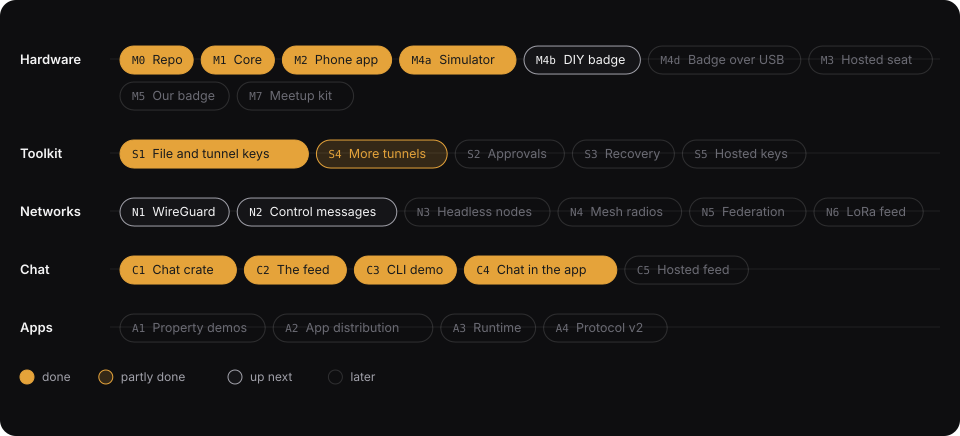

# Roadmap

Status reflects the `main` branch as of 2026-10-21.

## How to read this page

The work runs on five tracks. Each milestone has a short code, such as `M2`, that commit messages and issues refer to.

| Track | What it is about |
|---|---|
| Hardware | The badge, from a software-only simulator to the device we manufacture |
| Toolkit | Libraries that plug the shared secret into tools people already run |
| Networks | Using a group's secret to set up VPNs and mesh networks |
| Chat | Encrypted group chat and the public feed it runs over |
| Apps | Small programs that run on top of a group's message stream |

Status words mean exactly this:

- **done**: the code is merged and its tests pass in CI.
- **partly done**: some of the scope is merged. The row says what is missing.
- **up next**: the next thing to start on that track.
- **later**: waits on another milestone, named in the row.

A few terms repeat below. The [glossary](glossary.md) defines all of them. The ones you need most: a **cahoot** (or circle) is a group that shares one secret. The **pad** is that secret, a file of random bytes. The **feed** is the public bulletin board that carries encrypted messages. A **hosted seat** is a group member that is a program running in a secure cloud enclave instead of a person with a device.

## Hardware

Goal: a badge you can hold, that makes the secret in a room and never puts it on a network.

| Milestone | What it delivers | Done when | Status |
|---|---|---|---|
| M0 Repo | The repository, the build, and the automated checks | Every check passes on a fresh clone | **done** |
| M1 Core | The protocol as a plain library: the ceremony, the message format, the ledger of used bytes | The library passes its tests and the published test vectors, and builds for tiny chips with no operating system | **done** |
| M1b Sealed reveals | Reveals encrypted to every member with X-Wing (X25519 plus ML-KEM-768), each member's key bound into its commitment, so someone recording the ceremony from nearby learns nothing and a spliced cable is caught | Vectors published; the Rust tests, the simulator ring, and the browser end-to-end run all pass with sealed reveals | **done** (2026-10-21) |
| M2 Phone app | The browser app: runs a ceremony with no network by showing and scanning animated codes; sends and reads messages; optional YubiKey randomness | Three phones complete a ceremony with no network. The YubiKey path is labelled and its speed measured | **done** (camera scanning on a real iPhone and the YubiKey speed measurement are still unchecked) |
| M4a Simulator | A desktop program that behaves like a badge, so the badge firmware can be written and tested before any hardware exists | Four simulated badges complete a ceremony and show the expected six words | **done** |
| M4b Pico badge | The first real hardware, the tinkering family: a Pico 2 (W for wireless tinkering), an e-paper hat, two buttons and an Infineon Trust M secure element on one Qwiic chain, no soldering. The secure element adds a second random source, a wrapping key that never leaves the chip, and rollback-proof counters. Design in [Build a badge](diy-badge.md) | Four kits complete a ceremony over cables in under 30 seconds. The pad on flash reads as ciphertext without the chip. A restored flash copy is refused. The radio is off throughout | in progress on the ESP32-S3 first, since that board is on the bench: the firmware in `crates/esp32s3` builds and runs the pile and the ceremony with the laptop standing in for the other cards; the Pico port follows |
| M4d Badge over USB | The browser app talks to a badge over WebUSB or WebSerial: the phone scans codes for the badge and shows the badge's codes, and the secret never crosses the cable | A phone and a DIY badge complete a ceremony with a second phone and badge | after M4b |
| M3 Hosted seat | A group member that runs as a program inside a [Turnkey Verifiable Cloud](https://docs.turnkey.com/features/verifiable-cloud/overview) enclave, under a policy the group pinned | The acceptance scenario from the handoff passes | later |
| M4c Badge OS, hosted | The badge software running on the Baochip operating system (Xous), in an emulator | Passes the same device tests as the simulator | later |
| M5 Baochip badge | The native family and the badge we manufacture: the Dabao board (Baochip-1x, RISC-V, key store, RRAM) with the 1.54" e-paper, two buttons, and a UART link. No secure element needed | Four Dabaos complete a ceremony over wires, and so does a mixed group with Pico badges. The RRAM erase findings are written up | December 2026, when the boards ship |
| M6 Approvals from a badge | A badge approves what the hosted seat is allowed to send | A message approved on a badge posts and decrypts everywhere | after M3 and M5 |
| M7 Meetup kit | Everything needed to run a ceremony with strangers: a host guide, a big shared display, spare batteries, cases, and the magnetic connectors | A real meetup runs a ceremony with badges and phones in one group | after M4b |

## Toolkit

Goal: a developer who already runs WireGuard, encrypts files, or signs approvals can use a group's secret without learning the protocol.

| Milestone | What it delivers | Done when | Status |
|---|---|---|---|
| S1 File and tunnel keys | A library that hands out keys from the pad and records what was used, plus adapters for HPKE, `age` file encryption, and WireGuard | Two laptops encrypt a 1 GB file to a group. A reused key is refused. The key-derivation test vectors are published | **done** (the end-to-end run with the real `age` command is still pending) |
| S4 More tunnels | Adapters for TLS 1.3, MLS group messaging, and a finished WireGuard helper | Each adapter has a test against the real implementation | partly done: the WireGuard helper exists; its test against the real `wg` tool is pending |
| S2 Approvals | A verifier that a Turnkey policy can require: "a member of this group approved this action" | A forged or replayed approval is refused | after M3 |
| S3 Recovery | A recovery secret split among the group at the ceremony, so that any 3 of 5 members can restore it | Three shares recover the secret. Two shares reveal nothing | after M5 |
| S5 Hosted keys | A copy of the pad held in a cloud enclave, so a server can take part under a pinned policy | The server gets a key only when the policy allows it, and every use is logged | after M3 |

## Networks

Goal: a group that met once can set up a VPN or a mesh network with no coordination server and no certificate authority. The design is in [What it is for](use-cases.md), sections 3 to 5.

| Milestone | What it delivers | Done when | Status |
|---|---|---|---|
| N1 WireGuard | A command that sets up and rotates WireGuard tunnels between group members from the pad alone, with the handles and announcements carried by the feed or pasted | Two Linux hosts bring up a tunnel whose keys came only from the group. Rotation works. A replayed key is refused on both ends | **done** (2026-10-21): `scripts/wg-demo.sh` runs in CI between two network namespaces |
| N2 Control messages | Standard message types for "here is my public key", "here is a key for our tunnel", and "rotate now" | Test vectors are published and the app shows peer announcements | **done** for the format and the vectors (2026-10-21); the app does not show announcements yet |
| N3 Headless nodes | A way to hand a node with no screen, such as a router on a roof, its share of the pad from a badge, with the badge wiping its copy | A simulated node receives its share from a simulated badge, and the badge's copy reads back empty | after M4a, then M4b |
| N4 Mesh radios | Adapters for Meshtastic, Reticulum, and Wi-Fi mesh (802.11s). The design: LoRa carries the control messages, a faster radio carries the traffic | Each adapter has a test against the real stack, or a written manual test where that is impossible | **partly done** (2026-10-21): `cahoots-mesh` issues and rotates Meshtastic channel keys over the feed and prints the channel URL and CLI command; Reticulum and 802.11s next |
| N5 Federation | Pairwise secrets between each two members, so a member cannot forge another member's messages | Three devices complete the group and pairwise ceremonies. A member cannot post as another | after M4b |
| N6 LoRa control plane | A `Link` over an SX1262 LoRa radio, the station able to gateway packets it hears, and the WireGuard bootstrap driven entirely by `peer` and `psk` messages received over LoRa. The radio is a separate hat that goes on after the ceremony, so "no radio during the ceremony" is physically true | A node with only a LoRa radio joins an IP mesh with keys it received over the air, and a radio capture shows only noise | after M4b; the Pico family makes this a $20 hat |

N1 and N2 shipped first, because they needed no hardware. What a Tailscale-like mesh still needs on top: a `mesh` command that loops the pair steps over every announced peer, and a relay for hosts behind NAT, which WireGuard cannot do on its own.

## Chat

Goal: a group chat where the keys come from the pad and the messages travel over a public feed. The design is in [Chat](chat.md).

| Milestone | What it delivers | Done when | Status |
|---|---|---|---|
| C1 Chat crate | The chat encryption: keys derived from the pad, forward secrecy per sender, standard authenticated encryption | Three sessions exchange messages with key rotation, out-of-order delivery, and rejection of tampered or replayed messages | **done** |
| C2 The feed | The public relay (the Numbers Station): an append-only log where each entry is chained to the last, and which refuses any message that reuses pad bytes | Posting and reading work over HTTP. A tampered log refuses to start | **done** |
| C3 CLI demo | A terminal chat client for trying the protocol without hardware | Three terminals chat through one relay, rotate keys, and reject a tampered entry | **done** |
| C4 Chat in the app | A chat screen in the browser app, with a relay address setting | Two browser tabs chat through the relay | **done** |
| C5 Hosted feed | The relay running inside a [Turnkey Verifiable Cloud](https://docs.turnkey.com/features/verifiable-cloud/overview) enclave, with the head of its log anchored so it cannot be rewritten | The deployment pins the exact image, and the log head is anchored | after C2, needs [TVC](https://docs.turnkey.com/features/verifiable-cloud/overview) access |

## Apps

Goal: small programs, such as a vote, that every member runs over the same ordered messages and that can never touch the pad. The design is in [What it is for](use-cases.md), section 8.

| Milestone | What it delivers | Done when | Status |
|---|---|---|---|
| A1 Property demos | Four small demonstrations: hello words for calls, a fair random draw, SSH key setup from a group, and a tool that forges a plausible transcript to show that erased messages cannot be proven | Each has a test and a one-paragraph description of what it does and does not guarantee | **hello words done** (2026-10-21): pair keys from the sealed reveals, two words each way per hello number, Next on both devices to move on; in the app with vectors and an e2e test. The other three after M2 and N2 |
| A2 App distribution | A group agrees on an app the same way it agrees on the pad: by posting the app's hash. Clients refuse apps the group has not posted | A posted hash enables an app on every member's client. An unposted one is refused | after N2 |
| A3 Runtime | A sandbox in the browser app that runs these programs with a daily send budget, fixed message sizes, and a visibly separate frame | A vote app runs in three clients and agrees on the tally | after A2 |
| A4 Protocol v2 | Two protocol changes apps need: messages that hide who sent them, and messages that hide which group they belong to | Test vectors published. Version 1 and version 2 messages coexist | after A3 |

## Open decisions

1. ~~Where the repository lives.~~ Decided: `github.com/yourbuddyconner/cahoots`.
2. What the hosted seat runs: an agent that calls the app, or a model inside the enclave.
3. Whether the feed at a meetup is on the public internet or only the local network.
4. The badge screen: e-paper or OLED. Decided after comparing both on the Baochip board (M5).
5. When to involve marketing.
6. Which toolkit milestone to pitch to the first customer: approvals (S2) or recovery (S3).
7. Who reviews the approvals, recovery, and hosted-keys work before it ships.
8. Whether to buy an open-design USB random number generator as a second source that others can audit.
9. Whether to permanently enable secure boot and storage encryption on the spare ESP32-S3. Needs Conner's approval, because it cannot be undone. Less pressing now that the DIY badge is the first board.
10. Whether the first network demo is WireGuard between laptops (N1, no hardware) or a Meshtastic group (N4, needs radios). WireGuard ships faster. Meshtastic fits the community story better.
11. Whether pairwise secrets (N5) are worth the longer ceremony before a deployment with several parties needs them.
12. Whether apps (A2, A3) come before or after the hosted seat (M3). They share the control-message work in N2.
13. When to replace the fixed "one part of the pad per member" layout with a manifest written at the ceremony that names who may spend which bytes, for what. Decided on 2026-10-20 to adopt the manifest and drop delegation. The timing is open. The manifest should also record each member's device tier.
14. Device tiers below T3 are declared, not proven. Whether a phone (T0) may join a group of T3 badges at all, or only with a loud warning, is a product decision.
15. **New, 2026-10-21.** Hardware families. Decided: two to start, the Baochip (native, Dabao board, RISC-V, T3) and the Raspberry Pi Pico (tinkering, available now, wireless on the W, WebUSB, T2 with an Infineon Trust M). E-paper and two buttons on both; no joystick. More families welcome through the HAL. Open: the Pico screen, the 2.13" hat that plugs on or the 1.54" module both families would share; and whether a Pico badge's PIN is entered on the badge or on the phone.
