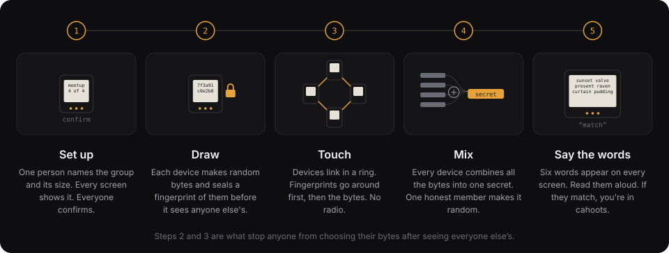

# Cahoots protocol, version 1

This is the normative description of what `cahoots-core` implements. The words MUST, MUST NOT, SHOULD, and MAY have their RFC 2119 meanings. All integers are little-endian.

## 1. Terms

- **Contribution `R_i`:** the random bytes member device `i` generates for a ceremony.
- **Pad:** `PAD = R_1 XOR R_2 XOR ... XOR R_n`.
- **Circle:** the set of members that hold one pad.
- **Slice:** a fixed, non-overlapping part of the pad assigned to one sender.
- **Spent:** pad bytes that were used to encrypt or decrypt a message. They MUST be erased and never used again.
- **Sealed reveal:** a contribution encrypted to every other member of the ceremony (section 3.2). The link never carries a contribution in the clear.

## 2. Parameters

| Name | Default | Notes |
|---|---|---|
| `n` | 2 to 8 members | |
| `L` | 16, 64, or 256 KiB; the app defaults to 64 KiB | On devices the maximum depends on free non-volatile memory. |
| Slices | `n`, plus 1 if the circle seats an agent | Equal sizes. Slice `k` starts at `k * floor(L / slices)`. |

Every slice MUST hold at least 32 bytes.

### 2.1 Encoding

The parameters are encoded once and bound into every commitment and the check words:

```
params = version (u8 = 1) | n (u8) | L (u32) | agent_seat (u8: 0 or 1) | name_len (u8) | name (UTF-8)
```

Implementation: `crates/core/src/params.rs`.

## 3. Ceremony

The ceremony is commit-then-reveal. Without the commit step, the last member to reveal could choose a contribution after seeing everyone else's and bias the pad.



1. **Setup.** The leader chooses the parameters. They are sent to every device. Phones show them for confirmation; on devices, a Params frame that does not match aborts the ceremony.
2. **Commit.** Each device generates `R_i`, a KEM keypair `(dk_i, pk_i)` from 32 more random bytes, and a seat key (section 3.4) from 32 more. It computes `C_i = SHA-256("cahoots/commit/v2" || params || i || pk_i || seat_pk_i || tier_i || R_i)`, in that order. `seat_pk_i` is the 33-byte compressed seat public key and `tier_i` is one byte, the declared device tier, 0 to 4, as on the [tiers](tiers.md) page. Every device sends `(C_i, pk_i, seat_pk_i, tier_i)` to every other device. All four are public. The seat key and the tier are in the commitment, so nobody can change either after committing. A device MUST NOT reveal until it holds all `n` commitments.
3. **Reveal.** Each device sends its sealed reveal (section 3.2): `R_i` encrypted to every other member. Each received reveal is opened and the contribution checked against `C_j`, using the `pk_j` held with the commitment, in constant time. A reveal that fails to open is refused and nothing changes. A reveal that opens but does not match aborts the ceremony on that device. A device that holds no commitment for `j` yet MAY take a sealed reveal from `j` as both: the commitment is derived from the opened contribution and the keys and tier in the blob. That is safe because the device's own contribution was fixed before it sent anything.
4. **Combine.** `PAD = XOR of all R_j`. A device MAY XOR a second independent source into its own `R_i` before committing. That source MUST NOT replace the device's own TRNG output.
5. **Circle ID.** `circle_id = SHA-256("cahoots/circle-id/v1" || PAD)[0..16]`.
6. **Attest.** Every member builds the manifest (section 3.5) and signs it (section 3.4). The ceremony is complete only when every seat has signed; a device shows no check words before then.
7. **Check words.** `check = SHA-256("cahoots/check/v1" || params || PAD)`. The first 66 bits are read as six 11-bit big-endian indices into the BIP-39 English wordlist. Every device shows the six words. Members read them aloud. A mismatch means the ceremony restarts.
8. **Erase.** Each device erases every `R_j` and keeps `PAD`, its seat key, the sealed manifest and its pair keys (section 3.3).

Implementation: `crates/core/src/ceremony.rs`, `commit.rs`, `reveal.rs`, `combine.rs`, `checkwords.rs`, `circle_id.rs`.

### 3.1 Touch-link framing

```
frame = type (u8) | seq (u32) | len (u32) | payload | CRC-32
```

The CRC is IEEE 802.3 (the same polynomial as zlib) over every byte before it. It catches transmission errors only. Commitments and check words provide integrity. Each device has one touch link per neighbour: two in a pile (down and up, the hardware design), two in a closed ring (previous and next), or one in a pair. The link carries five frame kinds: Params (1), Commit (2), Reveal (3), Abort (4), and Attest (5). A device forwards every frame it sees for the first time on every link except the one it arrived on, by its body (section 3.4), until all devices hold all `n` commitments, reveals, and attestations. The touch link MUST NOT use any radio.

Implementation: `crates/core/src/frame.rs`.

### 3.2 Sealed reveals

The ceremony link radiates: a wire, a USB cable, or a phone screen can be read by an antenna or a camera nearby. Without this section, an attacker in range during the ceremony records every contribution and holds the pad. With it, that attacker has to break X-Wing (X25519 and ML-KEM-768, both) for every member. Nobody else is affected: the pad is still the XOR of the contributions and never depends on the key exchange, so the claim against an attacker who was not in the room is unchanged.

The KEM is X-Wing (draft 06). `pk_i` is the 1216-byte encapsulation key derived from a 32-byte seed. Binding `pk_i` into `C_i` stops someone spliced into the cable from substituting keys: a reveal sealed with the real key then fails the commitment check and the ceremony aborts.

A sealed reveal from member `i` to the other members is:

```
version (u8 = 2) | i (u8) | pk_i (1216) | seat_pk_i (33) | tier_i (u8) | k (u8)
k × [ j (u8) | ct_j (1120) | wrap_j (48) ]
body = ChaCha20-Poly1305(K_i, nonce 0, aad = "cahoots/reveal/v1" || params || i || pk_i || seat_pk_i || tier_i, R_i)
```

- `K_i` is a fresh 32-byte content key.
- For each other member `j`, in ascending order: `(ct_j, ss_j) = XWing.Encaps(pk_j)` with 64 bytes of randomness, `wrap_key_j = HKDF-SHA256(salt = "cahoots/reveal-wrap/v1", ikm = ss_j, info = params || i || j)`, and `wrap_j = ChaCha20-Poly1305(wrap_key_j, nonce 0, aad = i || j, K_i)`.
- Every key is used once, so every nonce is zero.
- Randomness is drawn in this order: `K_i`, then 64 bytes per recipient. `randomness_len(n) = 32 + 64 (n - 1)`.

The header carries the seat key and the tier, and the body AAD covers them, so a blob whose header was altered fails to open. The AAD keeps the domain string `cahoots/reveal/v1`. The wrap AAD is unchanged. A reveal whose version is not 2 is refused.

Member `j` opens it by finding its entry, decapsulating `ct_j` with `dk_j`, unwrapping `K_i`, and decrypting the body. A failure anywhere is `corrupted`: nothing is learned and nothing changes. The opened `R_i` is then checked against `C_i`.

On the touch links, in a pile or a ring, sealed reveals are forwarded unchanged: every hop is a member and can open its own copy, so no per-hop session is needed. On phones, one animation carries the reveal to every scanner, since each scanner unwraps its own entry.

Implementation: `crates/core/src/reveal.rs`.

### 3.3 Pair keys and hello words

The sealed reveals leave every pair of members with two X-Wing shared secrets that nobody else can compute: the one `a` encapsulated to `b`, and the one `b` encapsulated to `a`. For members `lo < hi`:

```
pair_key(lo, hi) = HKDF-SHA256(salt = "cahoots/pair/v1",
                               ikm  = ss(lo → hi) || ss(hi → lo),
                               info = params || lo || hi)        32 bytes
```

Both members hold both secrets, so both derive the same key, and no third member can. Unlike the pad, this key is computational (as strong as X-Wing), and it names an individual: something produced under `pair_key(a, b)` came from `a` or `b`, whereas a pad message could have come from any member. A device keeps `n - 1` pair keys next to the pad. A circle made before sealed reveals has none.

Hello words are the spoken form. Each pair keeps a counter, and for each counter value each member has two words to say:

```
v = LE32(HKDF-SHA256(no salt, ikm = pair_key, info = "cahoots/words/v1" || speaker || LE32(counter))[0..4])
words(speaker, counter) = WORDLIST[v & 0x7ff], WORDLIST[(v >> 11) & 0x7ff]
```

One member says their pair, the other answers with theirs. A listener who records one side's words cannot answer as the other side, and either side moving the counter on makes everything recorded so far useless. The counter is not sent anywhere; both members move it, and the apps show its number so they can resynchronise by saying it. The words are a function of the key, so there is nothing to rotate but the counter: a key only changes when the circle is made again.

Implementation: `crates/core/src/pairwise.rs`. Vectors: `pair_keys` and `hello_words` in `ceremony.json`.

### 3.4 Attest

When the last reveal is in, the ceremony builds the manifest (section 3.5) from what it holds. Every device builds the same bytes. The phase is now Attest, and no member has finished yet.

**Seat keys.** A seat key is a P-256 key pair. Its 32-byte seed is the secret scalar, and a seed that is zero or not below the curve order is refused and drawn again. Signatures are ECDSA over SHA-256 of the message, as raw `r || s`, 64 bytes. A signature MUST verify under the seat key. Deterministic signing (RFC 6979) is recommended, not required, because a key in a phone's Secure Enclave signs with random nonces. The key is made at the ceremony, one per circle, and never reused across circles. The ring driver draws the seat seed from the entropy source after the KEM seed.

**Attestation.** Each member signs the manifest bytes once. The attestation is a detached COSE_Sign1 (section 8.1) with the manifest as payload, kid `[seat]` (the one byte of the seat index), and external AAD `cahoots/manifest/v1`. Each device checks every attestation it receives against the sender's seat key from the manifest and the kid. A bad signature is refused and does not abort. A later valid attestation for a seat already held is ignored, even if its bytes differ, because a seat key may sign with random nonces. The first one stays. The ceremony is complete when all `n` attestations are held.

**Attest frame.** `Attest` (5) carries `index u8 | COSE_Sign1 bytes`, at most 256 bytes after the index. A device sends its own as soon as the phase is Attest. It forwards and deduplicates attestations as it does reveals, and holds one that arrives before its phase is Attest.

**Phone.** The app carries the attestation as a third animated code after the reveal: pack kind 3, text form `cahoots-attest:<index>:<base64url>`.

Implementation: `crates/core/src/seat.rs`, `cose.rs`, `ceremony.rs`; `crates/hal/src/ring.rs`.

### 3.5 The manifest

The manifest is the circle's root document: the roster of seat keys and tiers, the circle's parameters, and the floor. It is one canonical CBOR map (section 8.1 defines canonical). An outside system registers a circle by registering its signed manifest.

| Key | Name | Value |
|---|---|---|
| 0 | version | 1 |
| 1 | circle_id | bstr, 16 bytes |
| 2 | params | bstr, the parameters encoding of section 2.1 |
| 3 | seats | array of seat maps, in seat order |
| 4 | floor | array of floor entries, in purpose order |
| 5 | genesis | uint, the log position of the ceremony, 0 |

A seat map is `{0: seat u8, 1: key bstr 33, 2: tier u8, 3: evidence bstr}`. `evidence` is empty in this version. It will hold a chip's proof that the key lives in it.

A floor entry is `{0: purpose u8, 1: requirement u8, 2: budget u32}`. The purpose is a control-message purpose (section 4.3). The requirement is `0` never served, `1` a grant suffices, or `2` the owner must be present. The default floor has one entry for each of the six purposes, 0 to 5, at requirement `2` with a budget of one slice, `slice_len()` bytes.

The manifest ID is the SHA-256 of the canonical bytes. A decoder MUST refuse anything that is not the canonical encoding: it re-encodes what it read and compares.

**Sealed form.** A sealed manifest is the CBOR array `[body, [attestation, ...]]`: the body bytes and one attestation per seat. It verifies when it holds exactly `n` attestations, each a COSE_Sign1 with the body as detached payload, external AAD `cahoots/manifest/v1`, kid `[seat]`, signed by that seat's key, with every seat present once. Each device keeps the sealed manifest with the circle, next to the pad and its own seat key.

Implementation: `crates/core/src/manifest.rs`.

### 3.6 The circle root

A circle root is a 32-byte secret that every member computes and no outsider can. It is `HKDF-SHA256(ikm, salt, info)`, where `ikm` is the content key of each seat's reveal joined in seat order, `salt` is the circle ID, and `info` is `cahoots/root/v1`. The content key of a reveal is the key that reveal is encrypted under. Every member opens every reveal, so every member holds all of them. The pairwise X-Wing secrets are not used, because they differ for each pair of members.

Two keys come from the root. The card seal key is `HMAC-SHA256(root, "seal/card" || circle_id)`. The chat key is `HMAC-SHA256(root, "chat" || circle_id || epoch)`, with the epoch as a big-endian u64. It keys chat epoch `epoch` (`docs/chat.md`). A badge computes the root at the ceremony. With a chip, it stores the root in the chip beside the seat key and keeps none in its circle record; without a chip, the root is in the circle record. Members who are honest get the same root. Nothing in the manifest or the check words checks that yet, so a member who sends different content keys to different members could split the root. A reveal sealed again under another content key by a member already revealed is refused as a conflicting reveal.

Implementation: `crates/core`.

### 3.7 The ceremony channel

A ceremony can run through a relay instead of animated codes. The rounds and the checks are the ones above. Only the way the bytes travel changes. The animated codes remain the way that needs no network.

1. The host draws a channel: a random 16-byte id and a random 32-byte key. It shows one static QR code. When no badges take part, the code's text is `cahoots:ceremony:v1:` followed by `id || key || host || relay_len || relay || params` in base64url without padding. When badges take part, it is `cahoots:ceremony:v2:` followed by `id || key || host || badges || relay_len || relay || params`. The v2 form adds the badge count and nothing else. `host` is SHA-256 of the host's commitment payload. The host's commitment is fixed when its ceremony starts, so the offer is made before anything is posted and never changes. `badges` is one byte, the number of badges in the pile, above zero and below the circle's size. Badges take seats 1 through `badges`. A client reads a v1 code as a circle with no badges. A code with a higher version number is from a newer version, and a client says so. `relay` is the host's relay address in UTF-8, at most 255 bytes, after its one-byte length. The parameters are in their encoding from section 2.1. Everyone joining uses the host's relay, and so does the circle the ceremony makes.
2. Each person joining scans that code from the host's screen and picks a seat. The code is shown in the room. There are no remote ceremonies.
3. Each member posts its commitment, then its sealed reveal, then its attestation to the relay under the channel id. It reads everyone else's from the same place.
4. After a joiner posts its commitment, it shows a small static code to the host: `cahoots:joined:v1:` followed by `id || seat || SHA-256(commitment)` in base64url without padding. The commitment is the commitment payload below. The host scans each joiner's code.

The host takes a seat's commitment from the relay only when its hash matches the code scanned for that seat. Until then it holds every commitment posted for that seat, and the seat's later messages wait. A commitment no scan matches never reaches the host's ceremony. The host's screen says so: "Seat N committed but was not scanned here." Once every seat is scanned, the host's screen says "Everyone is scanned". The host taps Continue, and only then posts its reveal. Joiners take commitments from the relay as they arrive.

Joiners check seat 0 the same way, against `host` in the offer. A seat-0 commitment whose hash does not match is held and never used, and the joiner's screen says "Seat 1 on the relay is not the host whose code you scanned." The host never loses seat 0 to an earlier commitment on the relay.

The relay only carries bytes. The offer binds the host's commitment, and each join code binds a joiner's. The two scans prove presence in both directions: each joiner scanned the host's screen, and the host scanned each joiner's screen. Someone who photographed the offer can post a commitment from anywhere. The host never takes it, so the host's manifest differs from the one the joiners build with the intruder in it, and nobody completes. If the host scanned the real person, the intruder's reveal does not match that person's commitment and the host stops. The six words then confirm the result for everyone who completes. Joiners seal their reveals to every KEM key they hold, an intruder's included. The intruder then learns contributions to a circle that never completes. That is harmless, because each ceremony draws fresh contributions.

```
message = 3 | id (16) | len (u32 LE) | seat | round | nonce (12) | ciphertext | tag (16)
```

`len` counts every byte after it. `round` is 1 for the commitment, 2 for the reveal and 3 for the attestation. The cipher is ChaCha20-Poly1305. Its key is `HKDF-SHA256(ikm = key, salt = id, info = "cahoots/ceremony/channel/v1")`. The nonce is random. The associated data is `id || seat || round`.

The plaintext is one part of a round's payload: `part (u16 LE) | parts (u16 LE) | bytes`. A payload is split into parts of at most 65,481 bytes, so each message fits in 64 KiB. Only a reveal for a large pad needs more than one part. The commitment payload is `C_i || pk_i || seat_pk_i || tier_i`, as in section 3. The reveal payload is the sealed reveal of section 3.2. The attestation payload is the signature of section 3.4.

A reader reads the channel in the relay's order. It opens each message and drops one that does not open. A stranger can post under the id, but cannot seal. The reader gives each complete payload to the ceremony. It holds a seat and round once the ceremony accepts its payload, and ignores later ones. A payload the ceremony refuses is dropped, and the seat and round stay open for the real one. Only an abort stops the ceremony.

The first commitment on the relay for a seat takes the seat. When two people pick one seat, the device whose commitment is second reads the other one first. That device has lost the seat. It posts nothing more and says so: "Seat N was taken by someone else. Leave and join again with a free seat." The others ignore its commitment, so nobody sees a reveal that does not match.

A ceremony lives in memory only. A device that closes cannot rejoin, because its old commitment is already on the relay. Everyone starts over with a new code.

The relay operator sees the channel id, the seats, the rounds, the sizes and the timing. The station leaves channel ids out of its public listings (`/v1/circles` and `/v1/feed`), so only someone who holds the id can read a channel. Nobody can read the payloads without the key. The key is only in the code on the host's screen. Members still read the six words aloud at the end.

Implementation: `crates/core/src/channel.rs`. Vectors: `crates/vectors/channel.json`.

## 4. Messages

The first byte of every message on the relay is its version: `1` a pure-pad message (this section), `2` a chat message ([chat specification](chat.md)), `3` a ceremony channel message (section 3.7), `4` a channel message (section 8.9).

Each message spends `32 + len` bytes from the sender's slice, starting at the sender's next unused offset `o`.

```
header  = version (u8 = 1) | circle_id (16 B) | slice (u8) | offset o (u32) | len (u16) | type (u8)
key     = PAD_slice[o .. o+32]
stream  = PAD_slice[o+32 .. o+32+len]
ct      = plaintext XOR stream
tag     = Poly1305(key, header || ct)       // 16 bytes; key is used exactly once
message = header || ct || tag
```

`type`: `0` text, `1` approve, `2` vouch, `3` control.

Poly1305 with a one-time key is a Wegman-Carter authenticator. It is information-theoretically secure for one use. Clients SHOULD pad plaintext to buckets of 32, 64, 128, or 256 bytes to hide its length. The bucket format places the plaintext first and the plaintext length in the last byte.

For posting, a message is encoded as base64url text, or as a QR code for single messages.

Implementation: `crates/core/src/message.rs`, `crates/core/src/pad.rs` (`bucket_pad`).

### 4.1 Sending

1. Compute `o` from the ledger: one past the highest spent offset in the sender's slice.
2. Read the `32 + len` byte range.
3. Mark the range spent. The ledger write MUST be durable before step 4.
4. Erase the range and verify by reading back.
5. Seal and return the message.

A crash between steps 3 and 5 loses a message. It never leaves a range reusable.

### 4.2 Receiving

1. Find the circle by `circle_id`.
2. Reject the message if its slice or range lies outside the pad.
3. Reject the message if any byte in `[o, o+32+len)` of that slice is already spent. Flag it as possible reuse. This check happens before the tag check so a replayed, tampered message is still reported as reuse.
4. Verify the tag in constant time. On failure, reject and mark nothing spent.
5. Decrypt, mark the range spent, and erase those bytes.

Implementation: `crates/core/src/pad.rs`, `crates/core/src/ledger.rs`.

### 4.3 Control messages

A `control` message (type `3`) bootstraps a network. Its plaintext is one subtype byte, then the fields below. All integers little-endian.

| Subtype | Name | Payload |
|---|---|---|
| `0` | `peer` | `proto (u8) \| pubkey_len (u8) \| pubkey \| endpoint_len (u8) \| endpoint (UTF-8) \| allowed_len (u8) \| allowed_ips (UTF-8)`. `proto`: `0` WireGuard, `1` Reticulum, `2` Yggdrasil, `3` Meshtastic. |
| `1` | `psk` | `purpose (u8) \| peer_a (u8) \| peer_b (u8) \| offset (u32)`. The issuer's slice is the message's own slice; `peer_a` MUST equal it. The core decoder does not check this; the consumer MUST (`crates/wireguard` does). `purpose`: `0` WireGuard, `1` TLS, `2` MLS, `3` Wi-Fi, `4` Meshtastic, `5` other. |
| `2` | `rotate` | `purpose (u8) \| peer_a (u8) \| peer_b (u8) \| not_after (u64 Unix seconds)` |
| `3` | `slice-transfer` | `member (u8)`. The member's slice now lives on a node, not a badge. |

A pre-shared key named by a `psk` message is the 32 bytes at `offset` of the issuer's slice, derived with the context `purpose || peer_a || peer_b`, so a key issued for WireGuard between A and B cannot be reused for another purpose or another pair. The acceptor marks that range spent in its own ledger; a second `psk` message for the same range is refused as reuse. `peer_b = 255` means every member: a group key, such as a Meshtastic channel key, which every member accepts from the same message.

Control messages are ordinary messages: they can be posted anywhere, including the Numbers Station, and only members can read or forge them. The feed only carries them.

Implementation: `crates/core/src/control.rs`; the WireGuard use is `crates/wireguard`.

## 5. Storage and erasure

- The pad lives in a dedicated region of non-volatile memory, not in a file on a filesystem with a translation layer.
- The spent-range ledger is updated with power-fail safety: write-ahead record, then erase.
- Erasure overwrites the bytes, then verifies by reading back.
- Phone storage gives no erasure guarantee. The phone client MUST say erasure is best effort.

## 6. Custodian messages (informative)

A custodian is a device or program that holds a pad and releases keys from it. A consumer asks a custodian for keys with the messages below. The messages are not part of the ceremony, and a client can follow version 1 without them. They are defined in `crates/custodian`.

Messages are CBOR (RFC 8949), array-encoded. A request travels in a frame of kind `KIND_REQUEST = 40`, and its response travels in a frame of kind `KIND_RESPONSE = 41`. A device that does not own these kinds ignores them.

| Request | Fields | Response |
|---|---|---|
| `Identify` | none | `Identity { circles, tier, name, chip }` |
| `Psk` | `circle`, `context` | `Psk { handle, key }` |
| `PskFor` | `handle`, `context` | `Key { key }` |
| `Spend` | `circle`, `len` | `Bytes { handle, bytes }` |
| `SpendFor` | `handle`, `len` | `Bytes { handle, bytes }` |
| `Remaining` | `circle` | `Remaining { bytes, low }` |
| `Chip` | `circle`, `op` | `Chip { result }` |

`Chip` is the family of things a badge does with its seat keys. `op` is one of:

| `op` | Fields | `result` |
|---|---|---|
| `Describe` | none | `Description { public, curve, in_chip, can_attest }` |
| `Attest` | `freshness` (16 bytes) | `Attested(..)`, the chip's attestation of the seat key |
| `SshSign` | `data`, `host` (optional), `content` (optional) | `Signature`, in SSH wire format |
| `Card` | `card` | `Signature`, a COSE_Sign1 |
| `GrantSign` | `grant` | `Signature`, a COSE_Sign1 |
| `Nonce` | none | `Nonce { nonce }`, the 16 bytes the next proof must be made over |
| `GrantRequest` | `action`, `author`, `location` (optional), `agent`, `budget`, `exp` (optional), `standing`, `cnf`, `time` | `Grant { grant, slot }`, a signed sign grant and the chip counter slot the badge gave it |
| `SshSignUnderGrant` | `data`, `content`, `grant`, `proof`, `location` (optional), `time` | `GrantSignature { signature, remaining }`, in SSH wire format, and the signatures the grant has left |
| `SealKey` | `label` | `Key { key }` |

`host` is `{ host_key, session_id, host_sig, name, user }`, what the laptop learned from OpenSSH. The badge checks it before it trusts it. `content` is the text a signature covers: a git commit (namespace `git`, which is refused without it) or a file in any other namespace. A file request without `content` is a signature over a hash the laptop chose, and the badge says so on its screen.

Any request can get `Error { code }` as its response. The codes are `UnknownCircle`, `Exhausted`, `AlreadySpent`, `OutOfRange`, `Config`, `Storage`, `Malformed`, `Denied`, `Busy`, `NoChip` (the badge has no chip to do this with), `ChipError` (the chip failed) and `Unparseable` (the bytes to sign are not something the badge signs).

`GrantRequest` asks the badge to issue a sign grant (section 8.3) to the agent key `cnf`. The badge shows the agent, the author, the budget, the end and the circle, and signs when both buttons are pressed. The place is the laptop's word, and the badge does not show it. It refuses an action other than `git-commit`, a budget outside 1 to 1000, an agent or author that would not show whole on its screen (39 and 48 printable ASCII characters), and a request with neither an `exp` nor `standing`, or with both. `time` is the laptop's clock in seconds. The badge keeps the latest time it was told and never goes back. `Nonce` gives the laptop the 16 bytes the agent's proof (section 8.3) is made over. The badge draws one nonce when its menu opens and keeps it until it accepts a proof under it, then draws another. Two `Nonce` requests with no use between them get the same bytes.

`SshSignUnderGrant` is a git commit signature the badge makes without a press, because a sign grant covers it. `grant` is the signed sign grant and `proof` is the agent's proof over the SHA-256 of `data` and a nonce from `Nonce`. The badge checks the grant against its own seat key and its own record, checks the proof, and checks the author in `content`, the place, the time and the budget. It counts the use in the chip before it signs. The badge asks its owner, as it would for `SshSign`, when the author, the place or the action is not the grant's, or when the request is not a git commit with its text. It refuses, asking nobody, when the grant is not this seat's or the badge has no record of it, when the proof is not by the grant's key over this request and nonce, and when the grant is revoked, expired or spent.

A request is at most 16 KiB. Only `SshSign` and `SshSignUnderGrant` may be longer than 4 KiB; any other request over 4 KiB is `Malformed`, and a badge refuses it before it asks its owner anything.

The laptop program and the badge firmware must come from the same release. `Identity` gained the field `chip`, and a decoder rejects any message that does not re-encode to the same bytes, so a laptop program from before it calls a new badge's `Identity` malformed.

A custodian MUST obtain its owner's consent before it answers any request except `Identify`, `Remaining`, and the `Chip` operations `Describe` and `Attest`. A custodian that is refused answers `Denied`. A badge asks for consent with a line on its screen, and its owner allows the request by pressing A and B together (A+B); A or B alone refuses it.

A badge answers `Busy` to a request that arrives on the words screen or on any menu item other than Serve, and ignores a request that arrives during the pile or the ceremony, so the laptop retries.

A custodian MUST accept only the canonical encoding of a message. It answers `Malformed` to trailing bytes, extra fields, truncation, and any encoding that differs from the one it would produce itself.

## 7. Test vectors

`crates/vectors/*.json` are generated from `cahoots-core` and `cahoots-objects` by `cargo run -p cahoots-vectors`, except `chat.json`, written by `crates/chat/tests/vectors.rs`, and `psk.json`, written by `crates/provider/tests/psk_vectors.rs`. They cover the ceremony (KEM seeds, public keys, sealing randomness, seat seeds and public keys, tiers, version 2 commitments and sealed reveals, each member's attestation, the manifest body and ID, the sealed manifest, a mismatch abort, and a garbled reveal), pair keys and hello words (`pair_keys` and `hello_words` in `ceremony.json`), the ceremony channel (`channel.json`: an offer with no badges and one with two, and a message sealed under a fixed nonce with its opening), control messages, check words, circle IDs, message encode and decode, a tag failure, reuse rejection, spend ordering, and framing. `objects.json` holds the signed objects of section 8: a root grant and a delegated grant in both versions, an approval, a fact, a receipt, a contact card with its sealed form, and the same card with a face and a device, each with its inputs, canonical payload, COSE_Sign1, and JSON projection, against a three-seat manifest. `channels.json` holds the channels of section 8.9: a link and the keys it derives, an epoch's keys and chains, a channel object, the policy presets and one signed policy, a grant chain of depth 2, a link deposit and a key deposit (each unsigned and signed), and a text message, a rotation, a revocation and an announcement; `crates/channel/tests/vectors.rs` reproduces it. Every client MUST reproduce them.

## 8. Signed objects

A seat emits five kinds of signed object: a grant, an approval, a fact, a receipt, and a contact card. Each is a canonical CBOR map signed as a COSE_Sign1. A signed object is a byte string. Anyone who holds the circle's signed manifest can verify one.

### 8.1 COSE profile

Every signature in Cahoots is a COSE_Sign1 (RFC 9052), so any COSE library verifies it.

- The structure is the untagged CBOR array `[protected, unprotected, payload, signature]`. `protected` is a byte string, `unprotected` is the empty map, `payload` is a byte string or nil (detached), and `signature` is 64 bytes.
- The protected header is the canonical map `{1: -7, 4: kid}`. Label `1` is `alg` and `-7` is ES256. Label `4` is `kid`, a byte string the signer chooses. A protected header with any other content is refused.
- For a seat, the kid is the one byte of the seat index. For a grantee key, it is the SHA-256 of the key's 33 bytes.
- The signature covers `Sig_structure = ["Signature1", protected, external_aad, payload]`, encoded canonically, with the seat key's ECDSA (section 3.4). A verifier checks the signature under the key and never compares signature bytes, since two valid signatures over the same bytes can differ.
- Canonical CBOR is RFC 8949 section 4.2.1: definite lengths, shortest integers, map keys in ascending order of their encoding. Every map here has integer keys in ascending order. A decoder MUST refuse a non-canonical encoding.
- The external AAD is the object's domain string. A signature made for one kind of object does not verify as another.

Implementation: `crates/core/src/cose.rs`. A test cross-checks a vector against the `coset` crate in both directions.

### 8.2 Assurance

Every approval carries an assurance level, how sure a verifier can be that the owner meant it.

| Level | Name | Meaning |
|---|---|---|
| 0 | claimed | Nothing was checked. |
| 1 | key | A signature from a key under a grant. |
| 2 | present | Both buttons pressed on a badge. |
| 3 | present with PIN | Both buttons pressed after a PIN. |

Higher includes lower. The device tier travels separately, in the manifest. See [tiers](tiers.md#assurance).

### 8.3 Grant

Domain `cahoots/grant/v1`. A grant is one of two kinds. A pad grant lets a key spend pad on some purposes, up to a budget and a log position, and lets that key delegate a narrower grant. A sign grant lets an agent's key sign git commits as a named author, a fixed number of times. The sections below give the pad grant first, in versions 1 and 2, and the sign grant after them.

| Key | Value |
|---|---|
| 0 | version, 1 |
| 1 | circle_id, bstr 16 |
| 2 | grantor: uint seat, or bstr 33 key for a delegated grant |
| 3 | grantee key, bstr 33 |
| 4 | purposes: array of uint, ascending, no repeats |
| 5 | budget, uint, bytes |
| 6 | not_after, uint, a log position |
| 7 | depth, uint, the delegations still allowed below this grant |
| 8 | parent: bstr 32, the SHA-256 of the parent's signed bytes, or nil for a root grant |
| 9 | nonce, bstr 16 |

A root grant is signed by a seat key with kid `[seat]`. A delegated grant is signed by the parent's grantee key with kid the SHA-256 of that key. A chain is checked root first. The root's signer is a seat in the manifest, it names that seat as grantor, and it has no parent. Each later link names the previous grantee as grantor and is signed by it. Its `parent` is the SHA-256 of the previous link's exact signed bytes. Its purposes are a subset. Its budget and `not_after` are no greater. Its depth is exactly one less than the previous depth, and the previous depth was not zero. Every link is in the manifest's circle. The result is the leaf grant.

#### Version 2: a CBOR Web Token

A version 2 grant has the same meaning and the same chain rules. Its payload is a CBOR Web Token claims set (RFC 8392), a canonical CBOR map, signed the same way under the same domain `cahoots/grant/v1`. A chain can mix the two versions. A verifier tells them apart by the first key: version 1 starts with key 0, which a CWT never has.

| Key | Claim | Value |
|---|---|---|
| 1 | `iss` (RFC 8392) | tstr `cahoots:circle:<circle_id as lowercase hex>` |
| 2 | `sub` (RFC 8392) | tstr `cahoots:key:<SHA-256 of the grantee key, lowercase hex>`, the grantee's key id |
| 7 | `cti` (RFC 8392) | nonce, bstr 16 |
| 8 | `cnf` (RFC 8747) | `{1: COSE_Key}`: the grantee key as `{1: 2, -1: 1, -2: x, -3: y}` (EC2, P-256, 32-byte coordinates) |
| -65537 | `cahoots-log` (private) | not_after, uint, a log position |
| -65538 | `cahoots-parent` (private) | parent, bstr 32; absent for a root grant |
| -65539 | `authorization_details` (RFC 9396, private key) | array of detail maps, below |
| -65540 | `cahoots-depth` (private) | depth, uint |
| -65541 | `cahoots-grantor` (private) | grantor: uint seat, or bstr 33 key for a delegated grant |

IANA's CWT Claims registry has no key for `authorization_details` (RFC 9396 registers it for JWT only), so it takes the private key -65539. The keys are in canonical order: the positive ones, then the negative ones from -65537 down.

Each detail is a map with text keys. `type` is `cahoots:<purpose>` for a purpose (`cahoots:wireguard` 0, `cahoots:tls` 1, `cahoots:mls` 2, `cahoots:wifi` 3, `cahoots:meshtastic` 4, `cahoots:other` 5), or `cahoots:purpose-<n>` for a purpose byte with no name. The purposes come first, in ascending order, with no repeats. The last detail is `{"type": "cahoots:pad", "budget": uint}`, the bytes of pad. In a pad grant only that detail has a `budget`.

A decoder MUST refuse a claims set with an unknown claim or detail type, a missing claim, an `iss` that does not name a circle, a `sub` that is not the key id of the `cnf` key, a named purpose written as a number, or a non-canonical encoding. The `cnf` key is the grantee: the next link in a chain must be signed by it, under its key id.

The badge signs root grants of either version for its own seat. Its screen shows the purposes, the budget and whether the grantee may delegate, all read from the grant. It marks two values with "(laptop)" because it cannot check them: the short key id of the grantee, and `not_after`, a log position the badge does not track.

#### Sign grant

A sign grant is a version 2 grant, a CWT claims set signed by a seat under kid `[seat]` and domain `cahoots/grant/v1`. A verifier tells it from a pad grant by its claims. A pad grant has the log claim -65537 and no `aud`, no `exp` and no `cahoots-base`. A sign grant has no log claim, an `aud`, a `cahoots-base`, and one detail of type `cahoots:sign`. It is never delegated: its depth is 0 and it has no parent.

| Key | Claim | Value |
|---|---|---|
| 1 | `iss` | tstr `cahoots:circle:<circle_id as lowercase hex>` |
| 2 | `sub` | tstr `cahoots:key:<key id of the agent's key, lowercase hex>` |
| 3 | `aud` (RFC 8392) | tstr `cahoots:seat:<circle_id as lowercase hex>:<seat>`, the seat that issued the grant and checks it |
| 4 | `exp` (RFC 8392) | uint, Unix time at which the grant ends. Absent for a standing grant |
| 7 | `cti` | nonce, bstr 16 |
| 8 | `cnf` | the agent's key, as in a pad grant |
| -65539 | `authorization_details` | array of one detail, below |
| -65540 | `cahoots-depth` | uint, 0 |
| -65541 | `cahoots-grantor` | uint, the issuing seat |
| -65542 | `cahoots-base` (private) | uint, the value the grant's use counter starts at on the badge that issued it. 0 on a badge without a chip |

The detail is `{"type": "cahoots:sign", "agent": tstr, "author": tstr, "budget": uint, "actions": [tstr], "locations": [tstr]}`. `agent` is a name for people to read. `author` is who commits are signed as, written exactly as the commit's author line. `budget` is 1 to 1000, the signatures the grant allows. `actions` is a non-empty list drawn from `git-commit`, `ssh-login` and `file`. `locations` names the repositories or hosts where the grant applies, and an empty list means anywhere. A location is compared with the scheme, `git@`, a trailing `.git` and a trailing `/` removed, `:` read as `/`, and the host in lower case. The path keeps its case. `agent` and `locations` may be absent. A badge today issues only `git-commit`.

The key -65539 is a private key, as for a pad grant, and stays until IANA registers one for `authorization_details` in the CWT Claims registry. The keys inside a detail are text and are written in RFC 8949 canonical order, shorter first and then bytewise: `type`, `agent`, `author`, `budget`, `actions`, `locations`. The claims are in canonical order too. A decoder MUST refuse a sign grant with a second detail, a missing `aud`, `cahoots-base`, `author`, `budget` or `actions`, a pad grant with a `cahoots-base`, an `aud` for another circle, a depth other than 0, a parent, or a non-canonical encoding.

A verifier answers one question: may this key do this action here and now. It takes a subject (the key id), an action, a resource (the circle and the place) and a context (the author named in the commit, the time, the signatures used, whether the grant is revoked), the shape of an AuthZEN access request. It checks in this order and stops at the first failure: revoked, key, circle, action, author, place, expiry, budget. A grant with an `exp` and a verifier with no clock is allowed, because only a verifier with a clock can judge expiry. The badge has its own time, the latest a laptop told it plus its uptime since, and it never goes back. A laptop can make a grant end early and cannot make it last longer.

On a badge with a chip, the chip counts the uses. Each grant has a counter in a chip slot. A grant starts its counter at its base, which is the chip-wide issue counter at the time of issue shifted up 32 bits, so a grant's uses are its counter less its base. The badge draws the base before it signs the grant and signs it in as `cahoots-base`. It reads the count against the base in the verified grant, never against the copy in its record, and a record whose base is not the grant's is refused as unknown. A later grant in the same slot has a higher base, so a flash image restored from before cannot refund a use, and a crafted record cannot point a grant at another grant's counter. The issue counter is kept when every circle is forgotten, so no base is given twice on one chip. A badge without a chip counts in its record, and its grants have base 0.

An agent proves it holds its key with a proof of possession. The proof is a COSE_Sign1 under external AAD `cahoots/proof/v1` and kid the key id of the agent's key. Its payload is the CBOR array `[data_hash, nonce]`, where `data_hash` is the SHA-256 of what the agent wants signed (bstr 32) and `nonce` is the 16 bytes the badge gave in answer to `Nonce` (bstr 16, section 6). The badge accepts the proof only for the nonce it gave. A proof does not verify under another nonce or another hash.

`objects.json` has a sign grant, signed by seat 1 for a fixed agent key, with its claims, its signed bytes, and a proof over a fixed hash and nonce.

### 8.4 Approval

Domain `cahoots/approval/v1`. A seat's verdict on a request. The fields are the lines the badge rendered, so the evidence says what the person saw.

| Key | Value |
|---|---|
| 0 | version, 1 |
| 1 | circle_id, bstr 16 |
| 2 | seat, uint |
| 3 | profile, tstr, the operation's profile name |
| 4 | fields: array of `[label tstr, value tstr]` pairs, in the order shown |
| 5 | request_digest, bstr 32 |
| 6 | policy_id, bstr |
| 7 | verdict, bool |
| 8 | assurance, uint, 0 to 3 |
| 9 | log, uint |
| 10 | nonce, bstr 16 |

Signed by the seat with kid `[seat]`.

### 8.5 Fact

Domain `cahoots/fact/v1`. A reading a seat took from a module, tied to a log position by its nonce.

| Key | Value |
|---|---|
| 0 | version, 1 |
| 1 | circle_id, bstr 16 |
| 2 | seat, uint |
| 3 | module, tstr, the catalogue entry that explains the reading |
| 4 | reading, bstr |
| 5 | counter, uint |
| 6 | nonce, bstr 32 |
| 7 | log, uint |
| 8 | attested, bool |
| 9 | evidence, bstr, the chip's attested-read response, empty when `attested` is false |

The nonce is `SHA-256("cahoots/fact-nonce/v1" || circle_id || log as 8 bytes, little-endian)`. A verifier recomputes it, so a reading cannot be moved to another position or circle. Signed by the seat with kid `[seat]`. See [attested readings](attested-data.md).

### 8.6 Receipt

Domain `cahoots/receipt/v1`. A record that a seat spent a range of the pad. This version defines the clear form. Sealing receipts to the circle comes later.

| Key | Value |
|---|---|
| 0 | version, 1 |
| 1 | circle_id, bstr 16 |
| 2 | seat, uint |
| 3 | slice, uint |
| 4 | offset, uint |
| 5 | len, uint |
| 6 | purpose, uint |
| 7 | grant, bstr 32, the SHA-256 of the signed grant it spent under, or nil |
| 8 | log, uint |

Signed by the seat with kid `[seat]`.

### 8.7 JSON projection

With the `std` feature, each object has a JSON form. It is informative: nothing verifies it, and the signed CBOR is the object. A grant becomes `{"authorization_details": [{"type": "cahoots/purpose", "purpose", "circle", "budget"}], "cnf": {"jwk": ...}, "exp_log", "depth", "parent"}`, with one authorization detail per purpose and the grantee key as a P-256 JWK. A version 2 grant's claims become `{"iss", "sub", "cti", "cnf": {"jwk": ...}, "authorization_details", "cahoots-log", "cahoots-parent", "cahoots-depth", "cahoots-grantor"}`, and a sign grant's also have `"aud"`, `"exp"` when it has one, and `"cahoots-base"`. An approval, a fact, a receipt and a contact card become flat objects with the field names of the tables, byte strings as lowercase hex, and `seat` and `circle` fields.

### 8.8 Contact card

Domain `cahoots/card/v1`. A seat's profile for its circle: a name, handles, and endpoints.

| Key | Value |
|---|---|
| 0 | version, 1 |
| 1 | circle_id, bstr 16 |
| 2 | seat, uint |
| 3 | name, tstr, 1 to 256 bytes |
| 4 | handles: array of `[kind tstr, value tstr]`, at most 16 |
| 5 | endpoints: array of `[purpose uint, value tstr]`, at most 16 |
| 6 | log, uint, the log position the laptop names |
| 7 | face, bstr 32, optional: the seed of the member's face |
| 8 | device, uint, optional: 0 phone, 1 badge, 2 browser, 3 laptop |

Keys 7 and 8 are optional. A card without them leaves them out, and the map has 7 or 8 entries instead of 9, so a card made before them reads the same. A card without a face is still a valid card. A reader shows a device number it does not know as no device. The face is drawn from the seed by `cahoots_core::faces::pixels`, 24 by 24 cells. A phone draws its seed once, from the system's generator, and may draw a new one, or use a seed of its own in one circle.

A handle's kind is a short text such as `email`, `github`, `nostr` or `x`, 1 to 16 bytes. An endpoint's purpose is a purpose byte 0 to 5, 6 for ssh, or 7 for chat. Its value is a text the laptop knows how to use: an address, a host, a chat address. Values are 1 to 256 bytes. The whole encoded card is at most 4000 bytes, so the request that carries it stays under 4 KiB; a longer one is `Malformed`. Signed by the seat with kid `[seat]`.

A phone or a browser publishes its signed card in the circle's chat as a message of type card (3). The plaintext is the signed card padded to a bucket as a text is (`docs/chat.md`), so the length of the name does not show on the wire. It is published after the ceremony, after each change of its name or face, and on a new relay when the circle moves to one. A reader verifies it against the manifest, refuses a card whose seat is not the message's sender, and keeps the newest card for each seat by the relay sequence number it was read at. A card message is never shown as text.

A signed card can also travel sealed for the circle, as a file. The sealed form is a random 12-byte nonce, then AES-256-GCM of the signed card under the card seal key, with additional data `cahoots/card/v1`. The card seal key is `HMAC-SHA256(root, "seal/card" || circle_id)`. The badge computes it from the circle root, in the chip when the root is there, and gives it to the laptop only after its holder presses both buttons. The screen shows "key for seal/card". The badge never seals. Before it signs a card, the badge checks that the card names the requested circle and the badge's own seat. Its screen then shows the name and how many handles and endpoints the card has.

Implementation: `crates/objects`.

### 8.9 Channels

A channel is a stream a circle publishes for people outside it. The circle that makes it is the owner. Anyone holding a grant for the channel may read it, and post to it if the grant allows. A channel has its own id, keys, policy and members, and its messages are version 4 messages on the relay. It is not the ceremony channel of section 3.7, which carries one ceremony and then ends.

A channel is conventional cryptography. Its keys are drawn by the owner's device, not spent from the pad, and no pure-pad claim applies to it.

A **member** is a P-256 signing key that holds a grant for the channel. The app makes one for each channel and keeps it in software, so posting never asks for Face ID. A member is not a seat and need not be in any circle. Beside the signing key, each member makes an X-Wing key pair for receiving key deposits. Each admin seat of the owner issues itself a root grant for a member key of its own, so a seat posts like any member and a seat key never appears as a message's `kid`.

Every log position below (`created_log`, a policy's `log`, a grant's `cahoots-log`, an approval's `log`) is the relay's sequence number, the `seq` it gives every entry it accepts, counted across all circles and channels. The relay keeps one hash chain over every entry, as before. A channel's head is its latest entry's `seq` and hash.

Implementation: `crates/channel`. Vectors: `crates/vectors/channels.json`, reproduced by `crates/channel/tests/vectors.rs`.

#### The channel object

Domain `cahoots/channel/v1`. A canonical CBOR map, signed as a COSE_Sign1 by an admin seat of the owner circle with kid `[seat]`.

| Key | Value |
|---|---|
| 0 | version, 1 |
| 1 | circle_id, bstr 16, the owner circle |
| 2 | channel_id, bstr 16 |
| 3 | name, tstr, 1 to 64 bytes |
| 4 | created_log, uint, the log position at which this object takes effect, 0 for the first |
| 5 | policy_id, bstr 32, the SHA-256 of the current policy's signed bytes |
| 6 | nonce, bstr 16 |

`channel_id` is the first 16 bytes of `SHA-256("cahoots/channel-id/v1" || circle_id || nonce)`. The object is published with the owner's sealed manifest, so any reader can verify the signing seat. A channel object is replaced, never edited: a new one with the same `channel_id` and a later `created_log` supersedes it. When the owner changes the policy, it signs a new object with the same name and nonce, the new `policy_id`, and `created_log` equal to the new policy's `log`.

#### The policy

Domain `cahoots/policy/v1`. Signed by an admin seat with kid `[seat]`. The policy ID is the SHA-256 of the signed bytes.

| Key | Value |
|---|---|
| 0 | version, 1 |
| 1 | circle_id, bstr 16 |
| 2 | channel_id, bstr 16 |
| 3 | rules, array of rule maps, in ascending action order, at most one per action |
| 4 | issuers, array of issuer maps |
| 5 | log, uint, the log position at which the policy takes effect |
| 6 | parent, bstr 32 or nil, the previous policy's ID |
| 7 | nonce, bstr 16 |

A **rule** is `{0: action, 1: evidence, 2: per_evidence, 3: quorum, 4: assurance}`.

- `action` is `0` read, `1` post, `2` admit, `3` govern (change the policy or the channel object, rotate, revoke).
- `evidence` is an array of evidence maps. A key that shows any one of them may be granted the action. An empty array means nobody may be granted it but the owner's seats. A missing rule means the same.
- `per_evidence` is how many member keys one piece of evidence may back, `0` for no limit.
- `quorum` is how many approvals from the owner's seats each use of the action needs. `0` means the grant alone is enough.
- `assurance` is the least assurance (section 8.2) those approvals must carry. The presets write `2`, present.

An **evidence** map is `{0: kind, 1: ref, 2: scope}`. `scope` is a tstr, empty when the kind does not use it.

| Kind | Name | `ref` | `scope` | Checked by |
|---|---|---|---|---|
| 0 | link | empty, or bstr 32, a link ID | unused | anyone: a gate token or a link deposit proves the secret |
| 1 | key | empty, or bstr 33, one explicit key | unused | the grant itself |
| 2 | circle | bstr 32, a manifest ID | unused | an issuer |
| 3 | document | bstr, the verifier's registry root | tstr, the nullifier scope | an issuer |
| 4 | account | bstr 32, an enclave measurement | tstr, the issuer and the predicate | an issuer |

A link entry with an empty `ref` means the owner's current link: the gate token the owner has registered on the relay names it, so retiring a link and issuing another needs no new policy. A key entry with an empty `ref` means any key the owner admits by hand. Kinds 0 and 1 are built. Kinds 2 to 4 are defined so that the policy does not change when they are built; no code checks them yet.

An **issuer** map is `{0: key, 1: endpoint, 2: measurement}`: a key that may issue grants and deposits for the channel, where to send a join request, and the enclave measurement when the issuer runs in one (nil otherwise). The owner's admin seats are always issuers and are not listed. In this version the list is empty and the owner's device issues.

The app writes one of five presets. Every preset has an admit rule with no evidence, and a govern rule with no evidence whose quorum is 1 for a circle of one seat and `seats / 2 + 1` otherwise.

| Preset | Read | Post |
|---|---|---|
| Announcements | link | no evidence: only the owner's seats |
| Announcements with approvals | link | no evidence, quorum `k` |
| Group chat | link | link |
| Members post | link | key, empty `ref` |
| Closed | key, empty `ref`: readers the owner admits by hand | no evidence |

The app sets a new policy's `log` to the previous policy's `log` plus 1, and its `parent` to the previous ID. A relay refuses a policy whose `log` is not greater than the current one's.

#### Keys and epochs

The owner draws 32 random bytes, the epoch root, for each epoch, and numbers the epochs from 1.

```
epoch_id    = channel_id (16) | epoch (u32 LE)
epoch_key   = HKDF-SHA256(salt = "cahoots/channel/epoch/v1" || epoch_id, ikm = root, info = "", 32)
chain[k][0] = HKDF-Expand(prk = epoch_key, info = "cahoots/channel/chain/v1" || kid, 32)
```

`kid` is the member key's key ID, the SHA-256 of its 33 bytes, as in a grant's `sub`. From `chain[k][0]`, message keys and later chain keys step as in the [chat specification](chat.md) section 2, with its zeroization and skip rules. Chains are keyed by key ID, so a channel can have more than 256 members and a member needs no seat. A reader keeps at most four epochs. The current epoch is the one with the highest number.

**Rotation** starts a new epoch. The owner sends a rotation control message (below) under the previous epoch, so every member who held it can read it, and then installs the new one. The first epoch has no previous one, so its rotation is sent under itself. A member who is shut out reads that control and learns only the new epoch's ID and the deposit IDs; it cannot open the deposits.

#### Deposits

Domain `cahoots/deposit/v1`. A deposit carries an epoch key to readers. It is stored on the relay and opaque to it. Its ID is the SHA-256 of its unsigned encoding, the map below; a rotation names deposits by that ID.

Every deposit is signed by the member key that issued it, a key whose grant carries `govern` (the member key an owner seat grants itself, above): a COSE_Sign1 with the deposit map as the embedded payload, kid the 32-byte key ID of the signing key, and external AAD `cahoots/deposit/v1`. The signed bytes are what the relay stores and serves. A reader fetches the signer's grant chain by that kid and installs a deposit only when the chain verifies against the owner's manifest, its leaf carries `govern` and is not revoked, its grantee's key ID is the kid, and the signature verifies under that key. A deposit that fails any check is ignored, and the reader goes on to the next one in the list. When the reader holds the rotation control that announced the epoch, it installs only a deposit whose ID the control names. A gating relay checks the same before it stores a deposit and refuses anything else with `403 {"error":"grant","reason":"action"}`. Anyone can seal to a link's seal key or a member's public X-Wing key; the signature is what says the owner made the deposit.

| Key | Value |
|---|---|
| 0 | version, 1 |
| 1 | channel_id, bstr 16 |
| 2 | epoch_id, bstr 20 |
| 3 | to, bstr 32: for a link, the link ID; for a key, the key ID of the member's signing key |
| 4 | kind, uint: `0` link, `1` key |
| 5 | sealed, bstr |

Both kinds use `aad = "cahoots/deposit/v1" || channel_id || epoch_id || to`.

- A **link deposit** is `ChaCha20-Poly1305(seal_key, nonce = epoch (u32 LE) || 0x00 * 8, aad, epoch_key)`, with the link's seal key (below). There is one link deposit per live link per epoch, so each nonce is used once.
- A **key deposit** is HPKE base mode with X-Wing to the member's X-Wing public key, info `cahoots/deposit/v1`, the same `aad`, and `epoch_key` as plaintext. `sealed = enc (1120) || ct`. Base mode has no PSK, since a reader holds no pad.

At each rotation the owner makes a link deposit for the live link, if there is one, and a key deposit for every member it has admitted.

#### Links

A link is

```
https://cahoots.network/app/#/ch/<relay host>/<channel_id hex>/<secret base64url>
```

The secret `s` is 32 random bytes. It is in the fragment, which browsers do not send to any server. Three values come from it:

```
link_id    = SHA-256("cahoots/link/id/v1" || s)
seal_key   = HKDF-SHA256(salt = "cahoots/link/seal/v1", ikm = s, info = channel_id, 32)
gate_token = HKDF-SHA256(salt = "cahoots/link/gate/v1", ikm = s, info = channel_id, 32)
```

The owner gives the relay `gate_token`, from which it cannot learn `s` or `seal_key`. A reader sends the token to fetch messages and deposits, and opens the link deposit with `seal_key`. A link is retired by removing its token from the relay and rotating without a deposit for it. A link without a secret names a channel whose read rule has no link evidence: only a member with a grant can read it.

#### Messages

A channel message is version 4 on the relay.

```
header  = version (u8 = 4) | channel_id (16) | epoch_id (20) | kid (32) | counter (u32 LE) | len (u32 LE) | type (u8)
nonce   = counter (u32 LE) | 0x00 * 8
ct      = ChaCha20-Poly1305(msg_key[kid][counter], nonce, aad = header, plaintext)
body    = header || ct
message = body || COSE_Sign1(payload = approvals, kid = kid, external AAD = "cahoots/channel-msg/v1" || body)
```

The header is 78 bytes. `len` is the plaintext length. `approvals` is a canonical CBOR array of signed approvals (section 8.4) as byte strings, empty for every message but an announcement. It is outside the ciphertext so that a relay can count it; the signature covers it and the body. The signature is by the member key. A reader verifies it against the key in the member's grant, which it fetches from the relay by `kid` and verifies up its chain to a seat in the owner's manifest.

`type` is `0` text, `1` control, `2` announcement. Text plaintext is bucket-padded as in the chat specification.

A **control** message's plaintext is a canonical CBOR map `{0: kind, ...}`. A control message needs a grant with `govern`.

| Kind | Name | Fields |
|---|---|---|
| 0 | rotation | `1: epoch_id bstr 20, 2: [deposit ID bstr 32, ...]` |
| 1 | policy change | `1: policy_id bstr 32` |
| 2 | revocation | `1: grant_id bstr 16, 2: reason tstr` |
| 3 | join | `1: grant_id bstr 16, 2: xwing_pk bstr, 3: name tstr, 1 to 64 bytes` |
| 4 | leave | none |

An **announcement** carries approvals in its COSE_Sign1 payload. Each approval has `profile` `channel-post`, `request_digest` the SHA-256 of the body, `fields` `[["channel", name], ["text", first line]]`, the current policy's ID, and a `log` the proposer names. A reader counts approvals from distinct seats of the owner's manifest at the post rule's assurance, and marks the post as an announcement only when the count reaches the post rule's quorum. A quorum of 1 still carries one approval. Readers in this version do not compare `fields` with the text.

#### Grants

A channel grant is a version 2 grant (section 8.3) under domain `cahoots/grant/v1` with one detail:

```
{"type": "cahoots:channel", "budget": uint, "actions": [tstr, ...], "channel": <channel_id, lowercase hex>}
```

The keys are in canonical order. `actions` is a non-empty subset of `read`, `post`, `admit`, `govern`, each once, in that order. `budget` is the number of posts the grant allows, `0` for no limit; it applies to `post` only. `iss` names the owner circle, `cnf` is the member key, and `cahoots-log` is the log position at which the grant stops holding. The `cti` is the grant's ID for the relay and for revocation.

The chain rules are those of section 8.3. A root grant is signed by an admin seat with kid `[seat]`; a delegated one by the parent's grantee. Down the chain, actions are a subset, the budget is no greater (`0`, no limit, is greater than any other budget), `cahoots-log` is no greater, and the depth is exactly one less. Only a grant that carries `admit` may have a child. A revoked grant ends every grant below it.

A seat's own grant carries all four actions, a budget of 0, depth 2, and no expiry (`cahoots-log` the largest u64). A grant the owner issues on admission is a root grant with the actions granted, a budget of 0, depth 0 and no expiry.

A verifier checks a request against the leaf in this order and stops at the first failure: revoked (any grant in the chain), key, channel, action, expired (the channel's head is at or past `cahoots-log`), budget (posts only). Readers in this version check the chain, the key, the revocations they have read and the action. The relay also checks expiry and budget.

#### Admission

A key asks to join with a join request: a COSE_Sign1 by the member key, kid its key ID, domain `cahoots/join/v1`, over this canonical map.

| Key | Value |
|---|---|
| 0 | channel_id, bstr 16 |
| 1 | member_key, bstr 33 |
| 2 | xwing_pk, bstr, the member's X-Wing public key |
| 3 | actions, tstr, the actions asked for, comma-separated, such as `read,post` |
| 4 | name, tstr, 1 to 64 bytes, the name the person typed |
| 5 | gate_token, bstr 32, or empty when the request comes without a link |

The request goes to the relay's queue for the channel. The owner's device reads the queue, checks the signature and the evidence against the policy, and on approval posts the grant, a key deposit for the current epoch, and a join control message. An action whose rule is missing or has no evidence (in every preset, `admit` and `govern`) is never granted. Without the owner choosing, a device grants only the subset of the requested actions whose rule has link evidence that the request's gate token proves against the live link; key evidence is always the owner's choice, by hand, of read, or read and post. A link holder reads before any of this: the link deposit is enough. The join request is for posting.

#### Governance and revocation

A governed change in a circle of several seats carries approvals with `profile` `channel-govern` and `request_digest` the SHA-256 of the signed object. A policy goes to the relay as `[signed policy, [approval, ...]]`. When the current policy's govern quorum is 2 or more, the change needs that many approvals from distinct seats, and the signing seat's own signature does not count toward them. In this version the app cannot collect governance approvals, so a circle of more than one seat cannot change a channel's policy.

The quorum applies only to policy changes in this version. A single seat, or any member key whose grant carries `govern`, can on its own rotate the epoch, revoke a grant, register or retire a gate token, and replace the channel object; the relay checks only that seat's signature, or the key's grant, for each of these. A circle whose seats do not trust one another should not rely on a govern quorum to stop one seat doing these things.

A revocation is two things: a revocation control message in the channel, which members read, and a statement for the relay, which cannot read the channel:

```
[grant_id (bstr 16), COSE_Sign1 by a seat, kid [seat], domain "cahoots/revoke/v1", over {0: channel_id, 1: grant_id, 2: reason}]
```

The owner registers a link's gate token on the relay with a COSE_Sign1 by a seat, kid `[seat]`, domain `cahoots/gate/v1`, over the canonical map `{0: channel_id, 1: gate_token}`. It retires the token with the same map signed under `cahoots/gate-retire/v1`.

## 9. The badge's chip

A badge keeps its seat keys and circle roots in an NXP SE051 secure element. The chip has two interfaces: I2C to the badge's Pico and a contactless one to its antenna. A phone paired to the badge reaches the chip over NFC with no help from the badge, which may be asleep or off. This section says what is in the chip, who may use it, and the bytes a phone reads and writes there. It describes applet 7.2.0 as measured on the bench on 2026-10-31. Implementation: `crates/chip/src/ids.rs` and `ops.rs`, `crates/badge/src/chip.rs`, `pairing.rs` and `public.rs`, and the phone's side in `crates/phone/src/apdu.rs`, `scp03.rs`, `nfc.rs` and `card.rs`.

### 9.1 Identities and policies

The chip names three identities:

- **Owner.** The badge's own session, opened over I2C against a user-id authentication object, the owner object. The badge's secret for it is `HKDF-SHA256(salt = "cahoots/owner/v1", ikm = board_id, info = empty)`, 16 bytes, where `board_id` is the RP2350's device id and then its wafer id, each 4 bytes little-endian, then its 128-bit RANDID from OTP rows 0x008 to 0x00F, each row's 16 bits little-endian in row order, 24 bytes in all. A reflash recovers it. Anyone who learns those inputs can open the owner session. A USB host can reboot the badge into BOOTSEL and read RANDID there, so a badge plugged into a USB host that is not trusted is retired.
- **Slot.** The paired phone's session, opened against the phone slot, an AES-128 authentication object. The session runs SCP03 (GlobalPlatform Amendment D) at security level `0x33`: command MAC, command encryption, response MAC and response encryption. The slot's one key serves as the encryption, MAC and key-encryption key.
- **None.** Any command sent to the chip with no session open. That is any tap, and the badge before its owner session opens.

Every object carries a policy fixed when it is made. For each identity the policy names, the chip keeps one entry of rights. A session the policy names gets that entry's rights only. A session the policy does not name gets the rights of the no-session entry. A right the slot holds under "SCP03" requires that the slot's session set up secure messaging. A refusal is status word `6986`.

| Object | Owner | Slot | None |
|---|---|---|---|
| Owner object | none | none | read its attributes |
| Seat key | sign, read the public key, attest, delete | none | none |
| Root, hello object | HMAC, delete | HMAC, under SCP03 | none |
| Epoch counter, grant counter, issue counter | read, move, delete | none | none |
| Public object | read, write, delete | read, under SCP03 | none |
| Pairing object | read, write, delete | read, under SCP03 | read |
| Inbox | read, write, delete | write, under SCP03 | write |
| Phone slot | delete | none | none |

Nobody may delete the owner object, not even its own session. The chip has no factory reset object and refuses DeleteAll in every session, so a tap cannot wipe a badge.

Any session may make an object at an id that holds nothing, and that object gets every right for every session. The bench made a binary object, an HMAC key, an AES key (an authentication object too), a P-256 key pair and a counter that way in no session. So a badge MUST NOT leave the phone slot, the inbox, the issue counter, the pairing object or the public object of a circle it keeps empty outside a conversation with the chip, and MUST NOT read back or keep an object at one of those ids that it did not make. It deletes and makes again any it finds missing or did not write, in one owner conversation, with its record flagged first so that a conversation cut off between the delete and the make is done again at the next boot. If an object at one of these ids cannot be deleted, the badge does not use the chip, or for a public object, leaves that circle out of pairing and drops its bump at an unpair.

A phone MUST read only the public objects of the circle slots the pairing object names, and MUST refuse two that name the same circle.

### 9.2 Object ids

Every Cahoots object id is `0x4C410000 | kind << 8 | slot byte`, sent to the applet big-endian. A circle's objects use its circle slot, 0 to 15.

| Kind | Object | Slot byte | Id |
|---|---|---|---|
| 1 | Seat key, P-256 | circle slot | `0x4C4101ss` |
| 2 | Root, an HMAC key | circle slot | `0x4C4102ss` |
| 3 | Chat epoch counter | circle slot | `0x4C4103ss` |
| 4 | Grant counter, one per sign grant | grant slot, below 8 | `0x4C4104gg` |
| 4 | Issue counter, the base of every grant | 255 | `0x4C4104FF` |
| 5 | Phone slot, AES-128 authentication object | 0 | `0x4C410500` |
| 6 | Hello object, an HMAC key | circle slot × 8 + other seat | `0x4C4106hh` |
| 7 | Public object, binary | circle slot | `0x4C4107ss` |
| 7 | Pairing object, binary | 255 | `0x4C4107FF` |
| 8 | Inbox, binary, 256 bytes | 0 | `0x4C410800` |
| 9 | Owner object, user id | 0 | `0x4C410900` |

While no phone is paired, the phone slot holds a random key nobody knows. The phone slot, the inbox, the issue counter, the public objects and the pairing object are the ids a tap could fill if they were empty. A tap can also fill the ids of a circle slot no circle uses, with objects nobody can delete. The badge then passes that slot over.

A hello object holds `HMAC-SHA256(32 zero bytes, pair_key)`, the extract step of the hello words (section 3.3) for the badge's seat and the other seat. The badge makes one for each other seat when it keeps a circle.

### 9.3 The pairing object

The pairing object is 128 bytes. It holds a canonical CBOR map, then zeros to the end:

| Key | Value |
|---|---|
| 0 | nonce, bstr 16. All zeros when no pairing is open |
| 1 | the badge's ephemeral public key for this pairing, bstr 33, P-256 SEC1 compressed |
| 2 | the badge's name, tstr, empty while the badge has none. A phone shows "your badge" for an empty name |
| 3 | circles, uint16: bit `s` set for each circle slot `s`, 0 to 15, whose public object the badge wrote and vouches for |

The badge makes the pairing object at its first boot, with a zero nonce, a zero key and no circles, and keeps it made: it writes over it in place. It draws a fresh nonce and a fresh ephemeral key pair when its owner opens `pair a phone`. It keeps the private key in RAM only. When the page closes, at a pairing, a decline and every boot, it writes a zero nonce and a zero key and drops the private key. It rewrites the circles at every keep, forget, pairing and unpairing, and at boot.

### 9.4 The inbox

The inbox holds a canonical CBOR map from its first byte. A reader decodes one map from the start and ignores what follows it, since a tap writes over the start and need not clear the rest. An inbox of zeros is empty.

| Key | Value |
|---|---|
| 0 | the phone's public key, bstr 33, P-256 SEC1 compressed |
| 1 | the phone's name, tstr, 1 to 64 bytes |
| 2 | the sealed slot key, bstr 65 |
| 3 | signature, bstr 64, P-256 `r || s` |

**The seal.** The phone draws a fresh 16-byte AES key for the slot and its own ephemeral P-256 key pair. It computes the x coordinate of ECDH between its ephemeral key and the badge's ephemeral key, and derives:

```
k = HKDF-SHA256(salt = nonce, ikm = x, info = "cahoots/pair-seal/v1"), 32 bytes
ciphertext || tag = ChaCha20-Poly1305(key = k, nonce = 12 zero bytes, aad = nonce || phone_public || name, plaintext = aes_key)
sealed = phone_ephemeral_public (33, compressed) || ciphertext (16) || tag (16)
```

`k` is used once, so the zero nonce is safe. `phone_public` is the phone's key at key 0, and `name` is the UTF-8 bytes at key 1.

**The signature.** ECDSA P-256 with SHA-256 by the phone's key over:

```
"cahoots/pair-inbox/v1" || nonce || badge_ephemeral_public || sealed || name
```

The badge checks the signature against the nonce and key of the pairing it has open, before it opens the seal. A request signed for an earlier pairing does not verify.

**The words.** Both sides show six words: the first 66 bits of

```
SHA-256("cahoots/pair-phone/v1" || nonce || badge_ephemeral_public || phone_public || aes_key)
```

read as six 11-bit big-endian indices into the BIP-39 English wordlist, as the check words are read (section 3, step 7). The owner presses both buttons only when the words match.

### 9.5 The public object

Each circle has one public object. The badge writes it when the circle is kept and again at every pairing and unpairing. Only the badge and its paired phone, in the slot's session, may read it. Objects made by the first firmware, which any session could read, are made again once under this policy at boot, with the same contents. A new one is its first contents plus 1024 bytes of room, at most 8192 bytes. It holds a canonical CBOR map with nine keys, every one present and in order, then zeros to the end. A reader MUST refuse anything else.

| Key | Value |
|---|---|
| 0 | circle_id, bstr 16 |
| 1 | relay, tstr. Empty means the phone's own default relay, since the badge knows no relay |
| 2 | the sealed manifest, bstr (section 3.5) |
| 3 | the badge's signed contact card, bstr (section 8.8), or null |
| 4 | the device grant for the paired phone, bstr (section 9.6), or null |
| 5 | the chat generation id after the pending bumps, bstr 32. The generation a newly paired phone fetches the key for |
| 6 | the pending bumps, an array of at most 4 bstr, oldest first, each moving from the generation the one before moves to. Empty when there are none |
| 7 | the badge nonce drawn at the badge's first boot, bstr 16, kept for the record |
| 8 | the paired phone's public key, bstr 33, or null |

When the contents do not all fit, a new object leaves out the card, then the grant.

**The pending bumps.** Each entry is a chat bump's payload, `from_id (32) || to_id (32) || COSE_Sign1`, the COSE_Sign1 detached, by the badge's seat key with kid `[seat]`, over `"cahoots/chat/bump/v1" || circle_id || from_id || to_id`. The badge signs one per circle when it unpairs a phone. It cannot post them, so the next phone that taps posts them to the circle's chat in order. A device may forward a bump signed by a seat when it is in the generation the bump moves from and does not hold the one it moves to.

At an unpair, with W→X the last pending bump and X the generation the badge recorded for the circle:

1. If no phone was paired since that bump, the badge replaces it with W→Y.
2. Otherwise it appends X→Y.
3. With no pending bump, or a last bump that does not end at X, the list becomes X→Y alone.
4. While the list holds more than 4, the two oldest, A→B and B→C, are replaced by one bump A→C, signed fresh. Members in B are stranded by that until any member with the root resets the chat.

The badge never removes a bump it cannot know was posted. A bump posted twice is stale the second time and moves nobody.

### 9.6 The device grant

A device grant is a version 2 grant (section 8.3), a COSE_Sign1 by the seat key in the chip with kid `[seat]` under the domain `cahoots/grant/v1`. Its claims are:

| Key | Claim | Value |
|---|---|---|
| 1 | `iss` | tstr `cahoots:circle:<circle_id as lowercase hex>` |
| 2 | `sub` | tstr `cahoots:key:<key id of the phone's key, lowercase hex>` |
| 7 | `cti` | nonce, bstr 16 |
| 8 | `cnf` | the phone's key, as in a pad grant |
| -65539 | `authorization_details` | `[{"type": "cahoots:device", "actions": ["read", "post", "hello"]}]` |
| -65540 | `cahoots-depth` | uint, 0 |
| -65541 | `cahoots-grantor` | uint, the seat |

`actions` is a non-empty subset of `read`, `post` and `hello`, each once, in that order. A decoder MUST refuse a device grant with a second detail, any other key in the detail, an `aud`, an `exp`, a log claim, a parent, a `cahoots-base`, a depth other than 0, or a grantor that is not a seat. A verifier checks it against the manifest: the kid names a seat, the seat's key signed it, the grantor is that seat, and `iss` is the manifest's circle. A chain check refuses a device grant, because a chain holds only pad grants.

The badge signs one per circle at pairing, and one for a circle it keeps while a phone is paired. It carries no channel detail. Nothing verifies it today except the phone, which takes the badge's seat from it at pairing. It has no expiry and no revocation. Unpairing clears field 8 of the public object at once, so a verifier that relies on a device grant MUST also check that the circle's public object still names the grantee.

### 9.7 What a slot may ask for

In the slot's session, under SCP03, a phone may MAC with HMAC-SHA256 (MACOneShot, algorithm `0x19`) under the circle's root and its hello objects, and may read every public object and the pairing object. The chip does not look at the data. The app asks for three things:

| Operation | Key | Data | Result |
|---|---|---|---|
| A chat generation key | root `0x4C4102ss` | `"chat/gen" || circle_id || generation_id` | the generation key, 32 bytes |
| Hello words | hello object `0x4C4106hh` | `"cahoots/words/v1" || speaker (u8) || counter (u32, little-endian) || 0x01` | the expand step of the hello words. The first 4 bytes give the two words as in section 3.3 |
| The card seal key | root `0x4C4102ss` | `"seal/card" || circle_id` | the card seal key (section 3.6). The app does not ask for it today, since cards travel in the chat |

Generation ids are random, except generation 0, whose id is `SHA-256("cahoots/chat/gen0" || circle_id)`. A phone cannot ask for a generation's key before a bump names its id, and a phone whose slot key was replaced cannot ask at all. The chip enforces no order, and a paired phone can compute any HMAC under the root while it is paired.

### 9.8 The applet's commands from a phone

A phone sends short APDUs only. It SELECTs the applet, `A0 00 00 03 96 54 53 00 00 00 01 03 00 00 00 00`. In no session it may read the size and the bytes of an object its policy lets any session read, which is the pairing object alone, and write into the inbox with WriteBinary. It never creates an object, so its WriteBinary carries no policy and no length. To open the slot it sends CreateSession for `0x4C410500`, then INITIALIZE UPDATE and EXTERNAL AUTHENTICATE inside ProcessSessionCmd with the session id. Every later command is wrapped under SCP03 first and then put inside ProcessSessionCmd. As measured on the bench:

- A wrapped command MUST NOT carry an Le. The applet answers one that does with `6982` and ends the session. The outer ProcessSessionCmd keeps its Le.
- The encryption counter advances on every command, with data or not.
- An error status comes back bare, with no response MAC.
- An id that holds nothing answers `6985`, for ReadSize, ReadObject, MACOneShot and CreateSession. `6A82` means only a SELECT of another applet.
- CreateSession while the badge's owner session is open is expected to answer `6985`, as the software chip does. The bench did not measure it. The phone then says the card is busy.
- Some answers use two-byte TLV lengths (`41 82 00 08 ...`). ReadSize answers a 2-byte size.
- The key information byte in the answer to INITIALIZE UPDATE is `03`. A phone refuses a card that does not offer SCP03.
