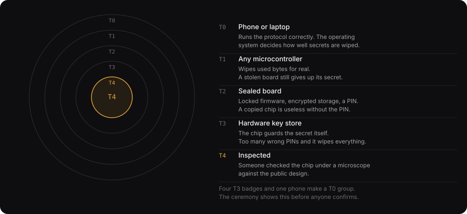

# Device tiers: concentric rings of security

Cahoots is open hardware and open protocol. Anyone can build a badge from whatever is on their bench, and a phone works with no hardware at all. The badge we make is the fully verified one. These tiers say what each kind of device protects, so that members know what they are getting and the software never claims more than the weakest device in the room can deliver.

## The rule that makes tiers matter

Every member holds the whole pad. A circle's protection against device theft or tampering is therefore the protection of its least protected member. The circle tier is the minimum of its members' device tiers, and the ceremony shows it before anyone confirms.

The randomness label (`TRNG` when every device used hardware randomness, `CSPRNG` otherwise) is a separate question, and it is also decided by the weakest member. A circle carries both labels.

## The tiers

| Tier | Device | What it protects | What it does not |
|---|---|---|---|
| **T0 Software** | A phone or laptop browser running the PWA | The protocol: correct spends, erase before send, constant-time tags, reuse detection | Anything about the platform. Erasure is best effort. A compromised OS reads the pad. |
| **T1 Open MCU** | Any microcontroller running `cahoots-hal` with a raw pad partition: the [DIY Arduino build](diy-badge.md) on an unfused Nano ESP32, and [V1](diy-badge.md) on a Pico 2 before the key store chip is on the board | Erase is real: spent bytes are overwritten in a raw partition and read back | A stolen device is a copy of the pad. Firmware can be replaced. The TRNG is whatever the chip has, with our health tests on top. |
| **T2 Sealed MCU** | The same MCU with secure boot and flash encryption fused, or any MCU with a secure element beside it that holds the pad's wrapping key and a counter the ledger is bound to. V1 reaches this tier with the SE051 on its next revision (M4f in the [roadmap](plan.md)); no Cahoots board is at it today | A dumped flash image is ciphertext. Only signed firmware runs. A restored flash copy is refused because the counter is ahead. A thief needs the PIN before the lockout | Without a secure element, the lockout counter lives in flash and can be rolled back. With one, the firmware still decides when to burn an attempt. |
| **T3 Key store** | A chip with a hardware key store, one-way counters, and a crypto engine that never exposes keys: the Baochip-1x, which is the chip in [V2](diy-badge.md) | The pad-wrapping key never leaves the engine. Failed PINs burn a one-way counter. After N failures the slot is erased and the pad with it. Boot stages lock the slot before the application runs | Physical attacks on the die. Flaws in the key-store controller, which still needs verification. |
| **T4 Inspected** | A T3 device whose silicon a member has compared with the published design under an infrared microscope, running firmware whose hash the circle pinned | The chip is what the RTL says it is. The firmware is what the circle agreed to | Supply-chain attacks between inspection and use. The inspection itself is a skill. |

Our badge targets T3 at launch and T4 for anyone willing to look.

## What each tier changes in the software

- **The ceremony screen** (planned) shows each member's tier and the resulting circle tier, next to the randomness label and the agent-seat warning. Members confirm all three.
- **The manifest** (planned) records each principal's declared tier. It is a claim, like the sender index. T3 and T4 devices can back the claim with a boot attestation posted as a control message (planned); T0 to T2 cannot.
- **The UI claim** follows the circle tier. A T0 circle says "erasure is best effort". A T2 or higher circle may say "a stolen device does not expose the pad without the PIN". No tier changes the confidentiality claim, which comes from the randomness label.
- **The burn procedure** (`docs/use-cases.md`) applies to every tier. Higher tiers make it needed less often.

## Building your own

The HAL is four traits: `Entropy`, `PadStore`, `Display`, `Link` (`crates/hal`). A new board is a crate that implements them. The host simulator is the reference implementation and also the test harness: a board passes the device suite by completing a ceremony over its links against simulated peers. The tier a board earns is decided by what its `PadStore` and boot chain can do. What the crate says about itself does not count. The README for each target states its tier and why.
