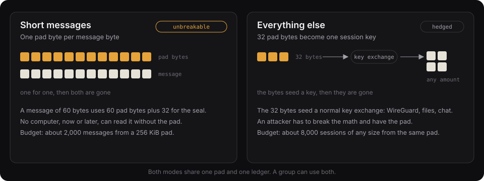

# What Cahoots is for

The ceremony produces one thing: a pile of random bytes that a small group shares and that nobody else has seen. This document lists what that pile is good for, from the obvious to the ambitious. The second half is a draft design for the most ambitious one: setting up a network, WireGuard first and then mesh networks, with no server and no certificate authority involved.

## 1. The two modes, restated

**Pure-pad mode** ([protocol](protocol.md), section 4). One pad byte per message byte, plus 32 bytes for the seal. Nothing about its security depends on math being hard. It fits short, high-value messages: a few hundred bytes at a time. A 256 KiB pad holds roughly 2,000 padded text messages across the circle.

**PSK mode.** 32 pad bytes become one session key, mixed into an ordinary key exchange with HKDF. PSK stands for pre-shared key. The session stays confidential if the math holds **or** the pad stays secret, so an attacker has to beat both. A 256 KiB pad holds about 8,000 sessions of any size. This is the mode for files, tunnels, and anything bigger than a text message.

The two modes share a pad, a ledger, and a circle ID. A circle can use both.

## 2. Concrete uses

### 2.0 Calls where you know who is talking

A cloned voice on the phone asking for money, a password, or a wire is now a cheap attack. The circle gives every pair of members a key only they hold, and the app turns it into **hello words**: two words you say, two words they say back, different for every hello and different for every pair. A clone of their voice cannot produce the words, and a recording of a past call does not help, because each hello is used once. If someone on the line is acting strangely, both of you tap Next; the person who cannot say the new words is not the person you made the circle with.

### 2.1 Group chat that cannot be broken later

This is the meetup demo. Members post encrypted messages to the public feed (the Numbers Station). Anyone who records the feed today and waits for a bigger computer, even a quantum one, still gets nothing. This is the only use where that guarantee holds end to end.

### 2.2 Approvals that do not depend on public-key crypto

An `approve` message carries the hash of an action, such as a transaction. The message type exists; the verifier is a design. A verifier that holds the pad checks the seal. A policy engine can require one of these next to a passkey or a signature. If signatures are ever broken, the approval still stands, because it never relied on one.

### 2.3 Encrypting files to a circle

`age -r age1cahoots1...` wraps the file key with 32 pad bytes. Two laptops that share a circle can exchange gigabytes after one ceremony. Each file spends fresh bytes, so a leaked file key reveals nothing about other files.

### 2.4 Hedging ordinary tunnels: WireGuard, TLS, MLS

Every one of these protocols already has a pre-shared-key slot that the designers added for exactly this reason: to hedge against the public-key layer failing. The slots are empty in almost every deployment because nobody has a good way to agree on the key. Cahoots fills the slot, because the in-person ceremony is the key agreement.

WireGuard's `PresharedKey` is the clearest case. The WireGuard paper describes it as a hedge against quantum attacks on Curve25519, mixed into the Noise handshake as the `psk2` modifier. Operators mostly leave it unset. See section 3.

### 2.5 Recovery circles

This is a design, not built. At the ceremony, one device splits a recovery secret into shares (Shamir's scheme) and hands each member one over the touch link. To recover, enough of those people meet again, or send their shares as pure-pad messages. It is social recovery, where the people are the ones you met in person.

### 2.6 Bootstrapping networks

This is the use the rest of this document is about. Every network has to start from something its members trust: a certificate authority's root, a coordination server's key, a vendor's signing key. Call that the network's starting trust. Today it is always downloaded from somewhere. A circle can be that starting trust instead, and it was made in a room by the people who run the network.

## 3. Bootstrapping a WireGuard network

### 3.1 The problem a circle solves

To set up a WireGuard tunnel between two machines, you need three things: each side's public key, each side's endpoint and allowed IPs, and, optionally, a pre-shared key. All three travel over some channel before the tunnel exists. In practice that channel is a chat message, a wiki page, or a coordination server. Each of those is a place where a key can be swapped or read.

A circle removes the channel. After members touch devices once, each of them can send the others a message that is private and provably from inside the group. No network or public key is involved.

### 3.2 How it works

This is built: `cahoots-wg announce`, `peers`, `issue --relay`, and `accept --relay` do it over the Numbers Station, and `scripts/wg-demo.sh` runs it end to end in CI between two Linux network namespaces. The relay is a channel the members do not have to trust: it carries sealed bytes and sequence numbers. The first tunnel can skip it entirely, with the strings pasted or exchanged at the ceremony.

Three message types do the whole job. They are circle messages, so they can be posted anywhere, including the Numbers Station, and only circle members can read or forge them.

1. **Peer announcement** (`control` message, subtype `peer`). A member posts its WireGuard public key, its endpoint, and its allowed IPs. Every member now knows every peer. The announcement is authenticated by the pad, so a swapped public key is detected.
2. **PSK issue** (`control`, subtype `psk`). To set up or rotate the tunnel to peer B, member A spends 32 bytes from its slice and posts the offset and the pair it is for. The message's own slice and circle complete the handle `(circle_id, slice, offset)`. B calls `psk_for(handle)` and spends the same bytes. Both sides now hold the same `PresharedKey`. The handle only says where the bytes are, so it can travel in the clear.
3. **Rotation** is a new PSK issue on a schedule. `cahoots-wg` renders the `[Peer]` block or runs `wg set` itself with `--apply`. The issuer installs the key when it issues and the acceptor installs it when it accepts. WireGuard holds one key per peer and switches at the next handshake.

Addresses need no server either: the circle ID picks a `10.x.y.0/24`, and seat k is `.k+1` (`cahoots-wg address`). A full mesh would be every host installing every other host's announcement, with one pre-shared key per pair, lower seat issuing to higher.

The first tunnel needs no network at all: the announcements and the first PSK issues can be exchanged over the touch link at the ceremony itself. After that, rotation handles travel inside the existing tunnel.

### 3.3 Pad budget

| Circle | Peer pairs | Rotation | PSKs per year | Pad needed |
|---|---|---|---|---|
| 4 nodes | 6 | weekly | 312 | 10 KiB |
| 8 nodes | 28 | daily | 10,220 | 320 KiB |
| 8 nodes | 28 | weekly | 1,456 | 46 KiB |

A 256 KiB pad lasts years at weekly rotation. On the ESP32-S3 the pad partition holds up to 1 MiB today, and the 8 MB of flash has room for more. The warning fires at 10% remaining, and the fix is a new ceremony.

### 3.4 What a member can and cannot do

Everyone in a circle holds the whole pad. That has two consequences for networks.

- **A member can read any PSK issued in the circle.** For WireGuard this does not break the tunnel today, because the handshake still needs the Curve25519 secrets. It does mean the pad hedge protects the fleet from outsiders. It does not protect members from each other.
- **A member can forge another member's announcement.** The circle tag proves that some member wrote a message. It does not say which one.

Both are fine when one operator runs every node. Call this the **fleet profile**: a person's home lab, a company's edge boxes, a research group's sensors. When the nodes belong to different people who do not fully trust each other, both are a problem, and that needs the **federation profile** in section 5.

## 4. Bootstrapping mesh networks

This is a design, not built. An IP mesh (802.11s, Wi-Fi HaLow) with WireGuard pairs is the WireGuard bootstrap in section 3 with more nodes, and the messages that set it up, `peer` and `psk`, are about a hundred bytes each.

### 4.1 Why mesh networks are the right target

Mesh networks have the bootstrap problem in its purest form. There is no internet to fetch a certificate from. Nodes join and leave, and links are slow, lossy, and sometimes one-way. Deployments happen in the field, by people with a bag of hardware. And the communities that build them, off-grid radio, disaster response, neighbourhood networks, already meet in person.

So the install goes like this. The crew runs the ceremony at the trailhead or in the van. Each node's badge, or the node itself, holds a part of the pad. The nodes then come up on the roof with every key they need, and they have trusted nothing from the network.

### 4.2 Where the pad bytes go

Each mesh stack has a slot that a circle can fill. The slot decides the mode.

| Stack | Slot | Mode | Notes |
|---|---|---|---|
| WireGuard overlay (wg-mesh, hand-rolled, or as the transport under batman-adv) | `PresharedKey` per peer pair | PSK | Section 3 applies unchanged. |
| 802.11s Wi-Fi mesh with SAE | Mesh password | PSK, via HKDF | One password per mesh. Rotation requires a coordinated restart, so rotate rarely. |
| batman-adv over WPA3 links | WPA3 passphrase per link | PSK | Same as above, per adjacent pair. |
| Yggdrasil, cjdns | Peer password / allowed public keys | PSK and announcements | The circle distributes the allowed-keys list. |

### 4.3 The mesh-specific gaps

Two things make mesh bootstrap harder than WireGuard between two servers.

1. **Nodes have no screen and no operator at join time.** A node mounted on a roof cannot read check words. The badge does the ceremony; the node receives its slice afterwards over USB or the touch link. That transfer is a pad-to-node provisioning step that the protocol needs to name. Draft: the node's part of the pad is written to the node's storage and the badge erases its copy, the same move as handing over a recovery share.
2. **Nodes join after the ceremony.** Adding a member without a new ceremony is out of scope for v1. The practical answer today is to run the ceremony with a spare slice held by the operator's badge and hand that slice to the new node. The spare is a member planned at the ceremony, so the pad is not extended.

## 5. Spec additions

### 5.1 Control message subtypes

Now normative: [protocol](protocol.md) section 4.3. Implemented in `crates/core/src/control.rs` and used by `cahoots-wg`. The table is kept here for the discussion that follows.

A `control` message's plaintext begins with one subtype byte.

| Subtype | Name | Payload |
|---|---|---|
| `0` | `peer` | `proto (u8) | pubkey_len (u8) | pubkey | endpoint_len (u8) | endpoint (UTF-8) | allowed_len (u8) | allowed_ips (UTF-8)`. `proto`: `0` WireGuard, `1` Reticulum, `2` Yggdrasil, `3` Meshtastic. |
| `1` | `psk` | `purpose (u8) | peer_a (u8) | peer_b (u8) | offset (u32)`. The issuing member's slice is the message's own slice. `purpose`: `0` WireGuard, `1` TLS, `2` MLS, `3` Wi-Fi/802.11s, `4` Meshtastic, `5` other. |
| `2` | `rotate` | `purpose (u8) | peer_a (u8) | peer_b (u8) | not_after (u64 unix seconds)` |
| `3` | `slice-transfer` | `member (u8)`. Announces that the member's slice now lives on a node, not a badge. Informational. |

The `context` bound into the PSK HKDF salt is the `purpose` byte followed by the two peer indices, so a PSK issued for WireGuard between A and B cannot be reused for TLS or for another pair.

### 5.2 The fleet profile and the federation profile

- **Fleet profile** (v1): one group pad, as specified. One operator, or a group that trusts every member with every tunnel. All of sections 3 and 4 work in this profile.
- **Federation profile** (later): at the ceremony, every pair of devices also touches directly and runs a two-member sub-ceremony. Each pair holds a **pairwise pad** that nobody else has. Pairwise pads prove which member sent a message with the pad's strength and keep each tunnel's key private to its two ends. The cost is `n(n-1)/2` touches, which is 28 for eight members. The group pad stays for circle-wide messages. Since sealed reveals, every pair already holds a **pair key** at X-Wing strength with no extra touches (protocol §3.3), which is enough for sender proof and hello words. The pairwise pad is for when the proof has to be unconditional.

The federation profile is the version that scales from "my boxes" to "our neighbourhood network".

### 5.3 Provisioning a slice to a headless node

1. The badge completes the ceremony and holds the full pad.
2. Over USB or the touch link, the badge writes the pad and its ledger to the node's pad partition and reads it back.
3. The badge erases its copy of the pad and verifies the erase.
4. The badge posts a `slice-transfer` control message.

A node provisioned this way holds the whole pad, as any member does. The federation profile changes this to the node's pairwise pads only.

## 6. The point, for networks

Every network today starts from a secret that someone downloaded and chose to trust: a certificate authority's root, a coordination server's key, a vendor's signing key. If that secret is bad, as the eMudhra keys were, everything built on it is bad, and nobody in the network can tell.

Cahoots replaces that downloaded secret with one the members made together, in the same room, on devices they can inspect. Nobody outside the room has seen it, so there is nothing for a third party to get wrong. For a mesh network on a hillside with no uplink, this is the only way the network can start at all.

A node that lives in the cloud, such as a gateway, can still take part: it holds its part of the pad inside a secure enclave under a policy the group pinned, and every key it issues or accepts is written to a log that cannot be rewritten.

## 7. Other properties worth building on

These follow from having shared random bytes and a record of which ones were used. Each is cheap because the pad does the work. What they add up to when everyone carries a card is in [Cards for every gathering](gatherings.md).

1. **Hello words** (built, 2026-10-21). Every pair of members leaves the ceremony with a key only those two hold, so the app can show two words for you to say and two for the other person to say back. A voice clone cannot produce them. If a call feels wrong, both people tap Next and the words change; whoever cannot say the new ones does not hold the key. This is the one feature that names an individual rather than the circle, and it is as strong as X-Wing rather than unconditional. See protocol §3.3 and the [app notes](../web/README.md#hello-words).
2. **Sender-anonymous messages.** The tag proves that some member wrote a message. It does not say which one. Reserve a shared anonymous region where members spend at random offsets and treat a collision there as a retry, and the circle has anonymous votes with information-theoretic strength. This is a protocol version 2 change, because it alters the reuse rule for one region.
3. **Perfect deniability after erasure.** For any ciphertext and tag there is a pad that decrypts it to any plaintext of the same length, including a Poly1305 key that reproduces the tag. Once the real bytes are erased, no transcript proves what was said. This holds only for human-only circles. The threat model should say so, and a "forge a transcript" tool makes it believable.
4. **Proof of life and a dead man's switch.** A daily counter sealed with the pad proves the sender is still there and still free. Hold recovery shares in an enclave with a policy that releases them when the daily messages stop, and it becomes a continuity plan with a verifiable trigger.
5. **SSH setup.** Peer announcements carry host and user keys. A helper writes `known_hosts` and `authorized_keys`. Today SSH trusts a host's key the first time it sees it and hopes nobody was in the way. With a circle, the key was vouched for by someone in the room.
6. **Fair draws.** Pad bytes used in order are random numbers that everyone holds and nobody chose. That gives lotteries and leader election with no server to trust.
7. **Ciphertext that looks like noise.** Pure-pad ciphertext is uniform. Hiding the circle ID behind a salted hash makes the whole message indistinguishable from random bytes, so it can be posted anywhere. Also a version 2 format change.

## 8. Circle apps: programmable logic without touching the pad

A circle is an authenticated broadcast channel, and the Numbers Station gives it a total order. That is the input a replicated state machine wants. A **circle app** is a WASM module with a pure `reduce(state, message) -> state` and a `render(state)`. Every member runs it over the same ordered plaintexts and reaches the same state. The pad is never an input, so apps cannot weaken it.

Invariants that apps must not cross:

- Only the provider reads pad bytes, and it erases before it returns anything.
- Tag checks are constant time and happen before anything is spent.
- No radio runs during contribution.
- The screen that shows check words and send confirmations belongs to the core, not to an app.

Design rules:

1. **The circle agrees on the app the way it agrees on the pad.** The module hash is posted as a control message. Clients refuse to run a module the circle has not posted.
2. **Apps spend, so apps get budgets.** Each action costs `32 + len` pad bytes. Apps get a daily send quota, bucket padding is mandatory, and any send the user did not initiate needs an on-screen confirmation. Bulk state travels in PSK mode.
3. **Sender identity is a convention.** Apps that count per member must declare that they need the federation profile.

| Host | Verdict |
|---|---|
| Phone and laptop clients, WASM reducers | Build first. Above the provider boundary, deterministic, hash-pinned. |
| [TVC](https://docs.turnkey.com/features/verifiable-cloud/overview), as a seat with a pinned policy | The agent seat generalized. The module hash belongs in the deploy record. |
| The badge, as a Xous detached app | Later. Needs the pad service to own the pad and the display. Not on the ESP32 build. |
| JavaScript plugins with pad access, or anything active during a ceremony | Never. |

The first app should be a vote. It exercises ordering, budgets, and the identity caveat at once.
