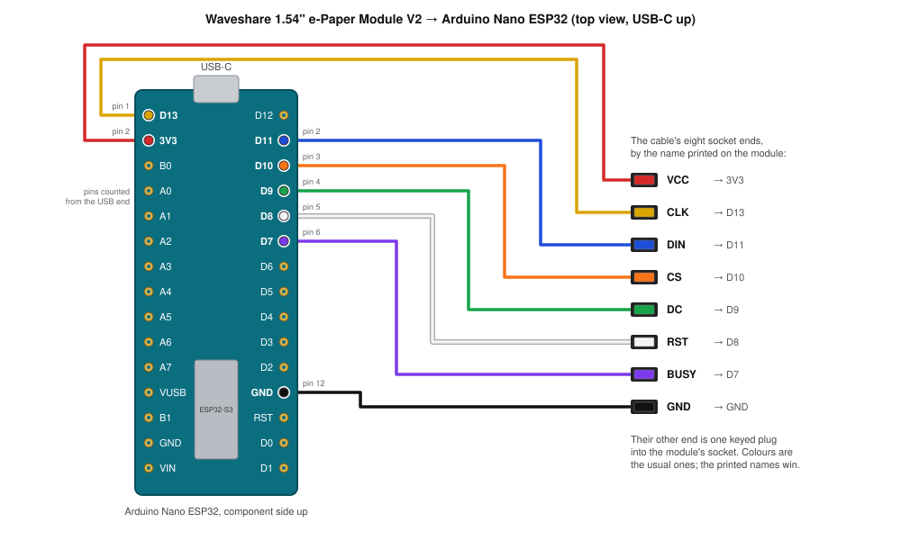

# Screen bring-up: Arduino Nano ESP32 and the Waveshare 1.54" V2

The first thing to check on the ESP32-S3 family's hardware, before any firmware exists: does the manufactured badge's panel, driven from a board we can buy today, show the badge's screens the way [Build a badge](../../docs/diy-badge.md) claims? The sketch in `epaper_bringup/` draws those screens and prints how long each refresh takes. It is a C++ Arduino sketch, not the badge firmware, which will be Rust on `esp-hal` with the `epd-waveshare` crate's `epd1in54_v2` driver for this same panel.

## Parts

- Arduino Nano ESP32 with headers, ABX00083. An ESP32-S3 with 16 MB of flash and 8 MB of PSRAM, USB-C, 3.3 V logic.
- Waveshare 1.54" e-Paper Module V2: 200 × 200, SSD1681 controller, SPI, the 8-pin cable. The same panel as the manufactured badge.

## Wiring

Read the labels printed on the module's board, not the wire colours. The module takes 3.3 V or 5 V on VCC; use 3V3 so every signal matches the Nano's logic level.

| Module | Nano ESP32 | Signal |
|---|---|---|
| VCC | 3V3 | power |
| GND | GND | ground |
| DIN | D11 | SPI MOSI |
| CLK | D13 | SPI SCK |
| CS | D10 | chip select |
| DC | D9 | data / command |
| RST | D8 | reset |
| BUSY | D7 | busy, high while the panel refreshes |



### Where those pins are

Hold the Nano component side up with the USB-C at the top. The headers are two columns of 15 pins.

- Left column, counting down from the USB end: pin 1 is D13 and pin 2 is 3V3. CLK and VCC go there. Pin 14, second from the bottom, is a GND.
- Right column, counting down from the USB end: pin 1 is D12, which stays empty. Pins 2 to 6 are D11, D10, D9, D8, D7, and DIN, CS, DC, RST, BUSY go onto them in that order, the same order the labels run on the module. Pin 12 is the other GND.

The kit's cable has a small 8-pin plug for the module and eight single female sockets at the other end. The names are printed on the module's driver board beside its connector, and the sockets are usually coloured red VCC, black GND, blue DIN, yellow CLK, orange CS, green DC, white RST, purple BUSY. Trust the printed names if the colours differ.

At the module end there is nothing to count: the plug is keyed. But if you want to check a wire, the names are printed on the back of the driver board beside the socket. With the board's text upright the socket is on the left edge, and the names read top to bottom BUSY, RST, DC, CS, CLK, DIN, GND, VCC. VCC is the pin nearest the Waveshare logo. Follow a wire from its position in the plug to its socket end and you have its name.

Two ways to join the sockets to the Nano's pins:

- **On a breadboard.** Seat the Nano across the centre channel. For each signal, push a male-to-male jumper into the breadboard row beside the pin and plug the cable's socket onto the jumper's free end.
- **Without one.** The sockets fit straight onto the Nano's header pins from the underside. Hold the board on its edge, push each socket on, and let the board rest on the cable. Fine for a desk test.

Leave the two solder-pad settings on the back of the module as shipped: 4-wire SPI is what the sketch uses. The board's version is printed on the back too. From V2.1 it has a level shifter and runs from 3V3; if an older board shows nothing, move VCC to VUSB for 5 V, and leave every signal on 3.3 V pins. Nothing else goes near VUSB or VIN: the Nano's pins are not 5 V tolerant.

## Buttons

Two 6 mm tactile switches, the square ones with four legs. Each goes between a pin and GND, and the chip's internal pull-up does the rest: no resistor.

| Button | Nano ESP32 pin | Meaning |
|---|---|---|
| A | D2 | next |
| B | D3 | confirm |

A four-pin switch has two pairs of legs joined inside it, and pressing joins the pairs. Legs that come out of the same edge are one pair. On a breadboard, set the switch across the centre channel so each pair sits on its own side; put the pin wire in a row on one side and the GND wire in a row on the other. If the two wires land on the same pair, the button reads pressed all the time, and the sketch says so on the serial monitor at boot.

With the buttons in, the screens are button-driven, as on the badge: A steps through words, QR at 6 px, QR at 5 px, waiting; B confirms where that means something, by partial refresh. After two idle minutes the panel sleeps and the next press redraws.

## Running it

In the Arduino IDE:

1. Boards Manager: install "Arduino ESP32 Boards". Select the board "Arduino Nano ESP32". Tools > Pin Numbering: "By Arduino pin (default)".
2. Library Manager: install GxEPD2. It pulls in Adafruit GFX Library and Adafruit BusIO. The QR generator is part of the board package.
3. Open `epaper_bringup/epaper_bringup.ino`, upload, open the serial monitor at 115200.

If the upload cannot find the port, double-press the reset button: the LED fades green and the board is in its bootloader.

The same from a terminal, with `arduino-cli`:

```sh
arduino-cli core install arduino:esp32
arduino-cli lib install GxEPD2
arduino-cli compile --fqbn arduino:esp32:nano_nora hardware/nano-esp32-epaper/epaper_bringup
arduino-cli upload -p /dev/cu.usbmodem* --fqbn arduino:esp32:nano_nora hardware/nano-esp32-epaper/epaper_bringup
arduino-cli monitor -p /dev/cu.usbmodem* -c baudrate=115200
```

## What it shows, and what to write down

A steps through the screens. B confirms. The serial monitor prints what each press did and how long each refresh took.

| Screen | Refresh | What to check |
|---|---|---|
| Words: circle name, tier label, six words in two columns, the confirm line | full | Can you read the six words from a normal reading distance? The layout is the site's render, `wordsScreen()` in `site/badge.js`, with the right column right-aligned. The font is FreeMono Bold at 12 px per letter and 17% taller than the stock 9pt, generated into `FreeMonoBold10pt7b.h`; a row holds 15 letters, and the one pair that cannot fit, 8 + 8 letters, drops that screen to the stock 9pt. `WORD_FONT` and `WORD_FONT_SMALL` in the sketch pick both. |
| B on the words screen writes "confirmed" on the footer; B on the waiting screen counts "commits 1/4" to "4/4" | partial, footer band only | How long does a partial refresh take, and does the rest of the screen flicker? This is what `show_status()` does during a ceremony. |
| Version 4 QR at 6 px per module, 198 px wide | full | The DIY guide's claim: a phone reads it at arm's length. Try a phone camera from 60 cm. The quiet zone is only the panel's bezel. |
| The same QR at 5 px per module, 165 px wide | full | The fallback if the first needs a real quiet zone. |
| Waiting: "touching..." / "wait for the buzz" | full | Legibility of the ceremony prompt. |

Numbers worth recording: the full refresh time, the partial refresh time, how many partial refreshes it takes before ghosting shows, and the distance at which each QR scans. Those feed the firmware's screen driver and the DIY guide's claims.

Measured on this pair on 2026-10-23, SPI at 1 MHz:

| Screen | Panel busy | Total, with the 5000-byte transfer |
|---|---|---|
| Full refresh | 1.29 s | 1.52 s |
| Partial refresh of the footer band | 0.33 s | 0.37 s |
| Version 4 QR | 33 modules: 198 px at 6 px per module, 165 px at 5 | |

## If the panel stays blank

Two things went wrong on the first try, and both are quick to tell apart.

- **No serial port on the Mac at all, and nothing on the USB bus.** The cable. Many USB-C cables carry power only. Swap in one that syncs a phone.
- **The log shows refresh times of a few milliseconds instead of about two seconds.** The panel never heard the commands. A real full refresh holds BUSY for 1.3 to 2 s. The library drives SPI at 10 MHz by default, and through the module's level shifter and jumper wires nothing got through; at 1 MHz everything works, and the sketch now sets that. If you change the wiring and the panel goes blank again, this is the first thing to suspect.

If both of those are fine and the panel is still blank, check the eight wires by the names printed on the module's back, not by colour, and that VCC is on 3V3 and GND on GND.

## What this does not test

One board tests one screen. The touch link needs a second board, or a laptop standing in as a peer over USB serial once the host crate has a serial link. The ceremony, the pad store on flash, and the entropy health tests need the ESP32-S3 crate, which does not exist yet: see [crates/esp32s3](../../crates/esp32s3/README.md).
